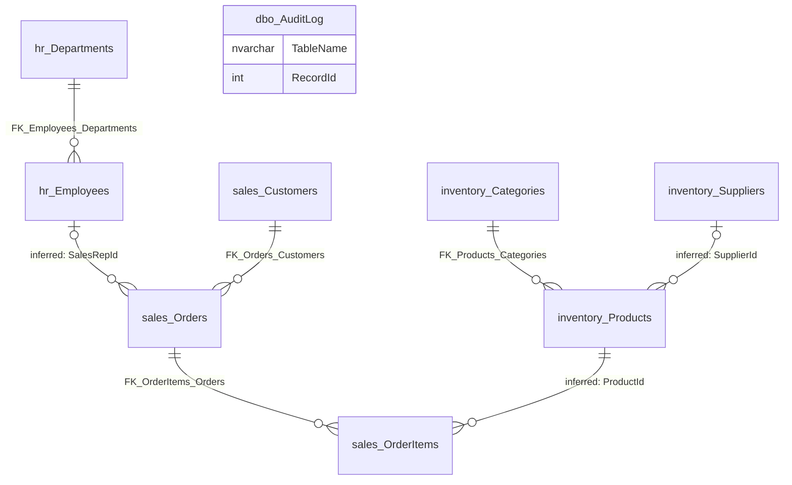

# SEH_Validation_Retail business areas

The ten tables are grouped into four business areas based on their schema names, table names, stored descriptions
and relationships. The export does not name business areas, so this grouping is inferred. See
[database-overview.md](database-overview.md) for the database as a whole.

## Overview

| Business area | Purpose (inferred) | Tables |
|---|---|---|
| Sales | Customers, their addresses, the orders they place and the order lines. | [sales.Customers](documentation/customers.md), [sales.CustomerAddresses](documentation/customeraddresses.md), [sales.Orders](documentation/orders.md), [sales.OrderItems](documentation/orderitems.md) |
| Products and inventory | The product catalogue with categories, prices, tax and stock, and its suppliers. | [inventory.Categories](documentation/categories.md), [inventory.Products](documentation/products.md), [inventory.Suppliers](documentation/suppliers.md) |
| Human resources | Departments and the employees in them, including sales representatives. | [hr.Departments](documentation/departments.md), [hr.Employees](documentation/employees.md) |
| Audit and change tracking | A technical log of changes to orders and employees, written by triggers. | [dbo.AuditLog](documentation/auditlog.md) |

## Business areas

### Sales

- **Purpose (inferred):** record who buys, where goods are delivered, what was ordered and the state of each order.
  The stored descriptions call `sales.Customers` "People and companies that buy from us" and `sales.Orders`
  "Customer purchase orders".
- **Tables:** `sales.Customers`, `sales.CustomerAddresses`, `sales.Orders`, `sales.OrderItems`.
- **Evidence:** all four tables are in the `sales` schema. Two foreign keys connect them (orders to customers,
  order lines to orders). The view `sales.vw_OrderSummary` and the procedure `sales.usp_GetCustomerOrders` belong
  to this schema.
- **Uncertainties:** `sales.CustomerAddresses` has no foreign key to customers or orders; its links are inferred.
  The meaning of order statuses beyond their names (New, Paid, Shipped, Cancelled) is not stored.
- **How the tables connect:** a customer places many orders (confirmed); an order has many order lines, which are
  deleted with the order (confirmed); a customer has one or more addresses, with at most one default (inferred);
  an order ships to one of those addresses (inferred).
- **Plausible processes and uses (inferred):** taking orders, payment and shipping status tracking (an index
  covers open orders with status New or Paid), customer service lookups of a customer's orders, sales reporting by
  region, customer and period.

### Products and inventory

- **Purpose (inferred):** maintain what is sold: product identity (SKU), name, category, supplier, price, tax rate,
  price with tax and stock quantity. `inventory.Products` has the stored description "Products we sell".
- **Tables:** `inventory.Categories`, `inventory.Products`, `inventory.Suppliers`.
- **Evidence:** all three tables are in the `inventory` schema. One foreign key links products to categories, and
  products have an indexed `SupplierId` column.
- **Uncertainties:** the supplier and parent-category links are not enforced. The currency of prices and the kind of
  tax (the default rate is 0.180) are not stated. Stock is a single quantity per product, with no warehouses or
  stock movements in the export.
- **How the tables connect:** each product belongs to one category (confirmed); categories can sit under a parent
  category (inferred); a product can come from one supplier (inferred, optional).
- **Plausible processes and uses (inferred):** catalogue maintenance, price and tax updates (a trigger records when
  a product was last modified), stock checks, supplier management and purchasing.

### Human resources

- **Purpose (inferred):** describe the organisation: departments with cost centres in a hierarchy, and the
  employees in them. The stored descriptions are "Organisational units. A department can sit under a parent
  department." and "People employed by the company, including sales representatives."
- **Tables:** `hr.Departments`, `hr.Employees`.
- **Evidence:** both tables are in the `hr` schema, and two foreign keys apply (department hierarchy, employee to
  department).
- **Uncertainties:** the manager link between employees is not enforced. `hr.Employees` also holds login and
  security data (user name, password hash, multi-factor secret, PIN, last login address, device), so the table
  serves application access as well as HR. That use is inferred from column names.
- **How the tables connect:** departments form a tree (confirmed); each employee belongs to one department
  (confirmed); employees can report to a manager (inferred).
- **Plausible processes and uses (inferred):** organisation charts, headcount by department or cost centre, payroll
  (salary), user access administration, and assigning sales representatives to orders.

### Audit and change tracking

- **Purpose (inferred):** keep a history of changes: which table, which row, what kind of change (insert, update,
  delete), when and by which database login.
- **Tables:** `dbo.AuditLog`.
- **Evidence:** the triggers `sales.trg_Orders_Audit` and `hr.trg_Employees_Audit` write to this table; a check
  constraint limits the action to I, U or D; defaults fill in the time and login.
- **Uncertainties:** the table has no primary key and no stored description. It records that a row changed, not
  which values changed. New employees are not logged.
- **How the tables connect:** through `TableName` and `RecordId`, which point to rows of different tables. This is
  not a database relationship (see [relationships.md](relationships.md)).
- **Plausible processes and uses (inferred):** change history for orders and employees, troubleshooting and
  compliance checks.

## Connections between areas

- **Sales and Products and inventory** connect through order lines: each order line refers to a product by
  `ProductId` (inferred, no foreign key).
- **Sales and Human resources** connect through orders: `SalesRepId` names the employee who handled the sale
  (inferred; the stored column description confirms the meaning but says the link is not enforced).
- **Audit and change tracking** is fed by triggers on `sales.Orders` and `hr.Employees`, not by a relationship, so
  it has no line in the diagram.
- Both links between areas are unenforced. Cross-area reports therefore depend on links the database does not
  check.

How to read the diagram: each name is a table (schema and table name joined by `_`), with the parent on the left of
each line. `||` means the child must have a parent; `|o` means the parent is optional; `o{` means a parent can have
zero, one or many children. Labels starting with `FK_` are enforced foreign keys; labels starting with "inferred:"
are links without a foreign key. Links inside an area that do not connect areas are left out here; see
[relationships.md](relationships.md).

## Reporting opportunities and limitations

Reports the data could support (inferred):

- Sales by customer, region, period, order status, product, category and supplier.
- Sales by sales representative and by department.
- Open order lists (status New or Paid) and shipping address lists.
- Product price lists with and without tax, and stock levels by category or supplier.
- Headcount and salary by department and cost centre; organisation charts.
- Change history of orders and employees.

Limitations:

- The database is very small (84 rows in total), so the samples show structure rather than real business volumes.
- The currency of amounts and the meaning of the tax rate are not stated.
- Links between areas are unenforced, so reports can silently lose or mismatch rows if the data breaks them.
- Order totals are stored separately from the calculated line totals; whether they always agree is not enforced.
- There is no stock history, no payment or invoice detail beyond order status and card fields, and no history of
  price changes (only the last modification time).
- Many columns hold sensitive personal, financial or security data. Reports must handle them under the
  organisation's privacy rules.

## Questions to validate

1. Is the four-area grouping (Sales; Products and inventory; Human resources; Audit and change tracking) how the
   business sees these data?
2. Should customer addresses be treated as part of Sales, or as part of a separate customer master data area
   together with `sales.Customers`?
3. Are the login and security columns in `hr.Employees` used by an application to sign employees in, and should
   they belong to a separate access-management area?
4. Which processes create and change orders (for example web shop, store, back office), and which statuses does
   each process set?
5. Is stock (`StockQty`) updated when orders are placed or shipped? The export shows no mechanism for it.
6. Which reports are used today, and which of them rely on the unenforced links between areas?
