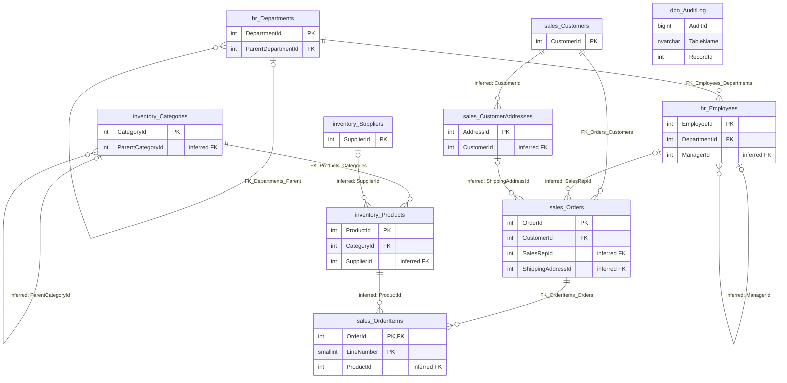

# SEH_Validation_Retail database overview

SQL Server, product version 16.0.1210.3 (Developer Edition, 64-bit); the database export was taken on 2026-10-26. Source: [database.json](../extracted/database.json).

## Summary

**Confirmed (stored description):** the database describes itself as a test retail database covering people,
customers, products and orders, in which some relationships were deliberately left without a foreign key.

**Inferred:** the ten tables support a small retail business:

- **Sales:** customers (`sales.Customers`) and their postal addresses (`sales.CustomerAddresses`) place orders
  (`sales.Orders`) made up of order lines (`sales.OrderItems`).
- **Products and inventory:** the product catalogue (`inventory.Products`) is grouped into categories
  (`inventory.Categories`) and sourced from suppliers (`inventory.Suppliers`), with prices, tax rates and stock
  quantities.
- **Human resources:** employees (`hr.Employees`) work in departments (`hr.Departments`); some employees act as sales
  representatives on orders.
- **Audit and change tracking:** a change log (`dbo.AuditLog`) records inserts, updates and deletes on employees and
  orders, written by database triggers.

Only 5 links between tables are enforced by foreign keys. Seven more links are clear from column names, stored
column descriptions, indexes and sample values, but the database does not enforce them (see
[relationships.md](relationships.md)).

## Source and scope

- **Export run:** 2026-10-26, completed successfully. The export reported no warnings and no errors.
- **Coverage:** all 4 schemas and all 10 tables. Each table has a structure file and a sample-data file
  (10 structure files and 10 data files written, none failed).
- **Sampling:** up to 100 rows per table, with text cut at 500 characters. Every table has fewer rows than that
  limit, and for every table the sample returned as many rows as the reported row count, so the samples appear
  to cover the whole content of each table at export time. Sampling strategies were "most recent by date column",
  "most recent by identity key" or "ordered by key", depending on the table.
- **Masking:** sanitization was on for every table. Columns the export classified as sensitive were masked in
  `hr.Employees`, `inventory.Suppliers`, `sales.Customers`, `sales.CustomerAddresses` and `sales.Orders`, and
  personal data in free text was redacted. Credential columns in `hr.Employees` and `inventory.Suppliers` were not
  read at all. `dbo.AuditLog`, `hr.Departments`, `inventory.Categories`, `inventory.Products` and
  `sales.OrderItems` had no column classified as sensitive, so nothing was masked there; the database logins in
  `dbo.AuditLog.ChangedBy` were therefore exported unmasked and are shown only as `[hidden]` in this documentation.
  This documentation never repeats masked values.
- **Row counts:** taken from the database catalog, not from an exact count, so they are treated as estimates even
  though they match the sample sizes.
- **Limitations:** only one view (`sales.vw_OrderSummary`) and one procedure (`sales.usp_GetCustomerOrders`) exist,
  and only their names and referenced tables are documented. Application code, business rules outside the
  database and the meaning of most columns (only 4 columns have stored descriptions) are not in the export.

## Database facts

| Fact | Value | Plain explanation |
|---|---|---|
| Name | SEH_Validation_Retail | The database's name. |
| Provider | SQL Server | The database product. |
| Product version | 16.0.1210.3 | The SQL Server release the database runs on. |
| Edition | Developer Edition (64-bit) | A non-production licence, which fits a test database. |
| Collation | SQL_Latin1_General_CP1_CI_AS | Text sorting and comparison rules: case-insensitive and accent-sensitive. |
| Compatibility level | 160 | The SQL Server behaviour level the database uses. |
| Creation date | 2026-10-26 13:18 (time zone not stated) | When the database was created or last restored. |
| Stored description | Yes (see Summary) | A description stored with the database. |
| Extended properties | None besides the description | Extra labels stored on the database. |
| Schemas | 4 | Named groups of tables: `dbo`, `hr`, `inventory`, `sales`. |
| Tables | 10 | |
| Columns | 92 | Across all tables. |
| Rows | 84 | Total of the catalog row counts (estimate). |
| Relationships (foreign keys) | 5 | Links enforced by the database; 7 more are inferred. |
| Indexes | 23 | Structures that speed up lookups, including primary keys and unique indexes. |
| Constraints | 37 | 9 primary keys, 5 foreign keys, 4 unique constraints, 7 check constraints, 12 default values. |
| Triggers | 3 | Code that runs automatically when rows change. |
| Views | 1 | `sales.vw_OrderSummary`, a saved query over orders, order lines, customers and employees. |
| Procedures | 1 | `sales.usp_GetCustomerOrders`, a stored routine that reads orders. |
| Functions | 0 | |
| Tables with a stored description | 5 of 10 | `hr.Departments`, `hr.Employees`, `inventory.Products`, `sales.Customers`, `sales.Orders`. |
| Columns with a stored description | 4 of 92 | `hr.Employees.ManagerId`, `inventory.Products.PriceWithTax`, `sales.Customers.Region`, `sales.Orders.SalesRepId`. |
| Sensitive columns | 34 | Columns that the export classified as personal, financial or secret data (a heuristic classification). |

## Schemas

All four schemas are owned by `dbo`, and none has a stored description.

| Schema | Owner | Description | Tables | Views | Routines |
|---|---|---|---|---|---|
| `dbo` | dbo | None stored | 1 (`AuditLog`) | 0 | 0 |
| `hr` | dbo | None stored | 2 (`Departments`, `Employees`) | 0 | 0 |
| `inventory` | dbo | None stored | 3 (`Categories`, `Products`, `Suppliers`) | 0 | 0 |
| `sales` | dbo | None stored | 4 (`CustomerAddresses`, `Customers`, `OrderItems`, `Orders`) | 1 | 1 |

## Table inventory

| Table | Business area | Purpose | Rows |
|---|---|---|---|
| [dbo.AuditLog](documentation/auditlog.md) | Audit and change tracking | Inferred: log of inserts, updates and deletes written by triggers. | 28 |
| [hr.Departments](documentation/departments.md) | Human resources | Organisational units, which can sit under a parent department. | 5 |
| [hr.Employees](documentation/employees.md) | Human resources | People employed by the company, including sales representatives. | 6 |
| [inventory.Categories](documentation/categories.md) | Products and inventory | Inferred: product categories, which can form a hierarchy. | 5 |
| [inventory.Products](documentation/products.md) | Products and inventory | Products we sell. | 7 |
| [inventory.Suppliers](documentation/suppliers.md) | Products and inventory | Inferred: companies that supply products. | 3 |
| [sales.CustomerAddresses](documentation/customeraddresses.md) | Sales | Inferred: customers' postal addresses, used for shipping. | 7 |
| [sales.Customers](documentation/customers.md) | Sales | People and companies that buy from us. | 6 |
| [sales.OrderItems](documentation/orderitems.md) | Sales | Inferred: the product lines of each order. | 10 |
| [sales.Orders](documentation/orders.md) | Sales | Customer purchase orders. | 7 |

Purposes without "Inferred" are the descriptions stored in the database. All row counts are catalog estimates.

- **Tables without a primary key:** `dbo.AuditLog`.
- **Tables without relationships (no foreign key in or out):** `dbo.AuditLog`, `inventory.Suppliers`,
  `sales.CustomerAddresses`. Inferred links connect `inventory.Suppliers` and `sales.CustomerAddresses` to other
  tables; `dbo.AuditLog` refers to rows of other tables only through a table name and record number.
- **Empty tables:** none.
- **Largest tables:** `dbo.AuditLog` (28 rows), `sales.OrderItems` (10), then `inventory.Products`,
  `sales.CustomerAddresses` and `sales.Orders` (7 each).
- **Root tables (referenced by foreign keys but referring to no other table):** `hr.Departments` (it refers only
  to itself), `inventory.Categories`, `sales.Customers`.

## Related documents

- [relationships.md](relationships.md): every enforced foreign key, the inferred links without one, rejected
  candidates and guidance on joining the tables.
- [business-areas.md](business-areas.md): how the tables are grouped into four business areas and what processes
  and reports each area supports.

## Evidence labels

- **Confirmed structure:** read directly from the database's own definitions: tables, columns, data types, keys,
  constraints, indexes and triggers. The database enforces these.
- **Reported profile:** statistics the export calculated, for example row counts and value distributions. The scope
  (sample or whole table) is stated where used.
- **Observed sample:** patterns seen in the sample rows. Samples can be small, so a pattern is not a rule.
- **Inferred:** our interpretation of meanings, business areas and links without a foreign key. It needs
  confirmation by the business.
- **Unknown:** what the export does not establish.

## Entity relationship diagram

How to read the diagram:

- Each box is a table (schema and table name joined by `_`); only key columns are shown. PK is the primary key,
  FK a column with an enforced foreign key, "inferred FK" a column that appears to refer to another table without
  a foreign key.
- Each line joins a parent table (left) to a child table (right). `||` means the child must have exactly one
  parent; `|o` means the parent is optional (the linking column can be empty). `o{` means a parent can have zero,
  one or many children.
- Lines labelled with a foreign key name (`FK_...`) are enforced by the database. Lines labelled "inferred" are
  not enforced: the database accepts values that match no parent row.
- `dbo_AuditLog` has no lines: it records the table name and row number of changed rows, which is not a
  relationship the database can express (see [relationships.md](relationships.md)).

## Safeguards and observed patterns

**Confirmed structure:**

- **Primary keys** on 9 of 10 tables; `sales.OrderItems` uses a two-column key (`OrderId`, `LineNumber`). All other
  primary keys are single auto-numbered (identity) columns. `dbo.AuditLog` has no primary key.
- **Foreign keys:** 5, all enabled and trusted (the database has checked all existing rows). Deleting an order
  deletes its order lines (cascade); the other four block deletion of a parent row that still has children.
- **Unique rules:** department names, category names, product SKUs and employee email addresses must be unique.
  Customer email addresses must be unique when filled in (filtered unique index). Each customer can have at most
  one default address (filtered unique index on `CustomerId` where `IsDefault` is 1).
- **Check constraints (7, all enabled and trusted):** audit action must be I, U or D; department cost centre must
  have the form "CC" followed by four digits; product unit price must not be negative; customer region must be
  North, South, East or West; order line quantity must be greater than zero; order status must be New, Paid,
  Shipped or Cancelled; order total must not be negative.
- **Defaults (12):** for example, new orders get status New, total 0 and the current time as order date; new
  products get a tax rate of 0.180 and stock 0; new suppliers get country "IN"; audit rows get the current time
  and the current database login.
- **Calculated columns:** `inventory.Products.PriceWithTax` (unit price × (1 + tax rate)) and
  `sales.OrderItems.LineTotal` (quantity × unit price).
- **Triggers (3, all enabled):** `sales.trg_Orders_Audit` logs every insert, update and delete of orders in
  `dbo.AuditLog`; `hr.trg_Employees_Audit` logs updates and deletes of employees (not inserts);
  `inventory.trg_Products_ModifiedAt` sets a product's last-modified time when it is updated.
- **Concurrency:** `inventory.Products.RowVer` is a row version that changes on every update.

**Observed sample:**

- All inferred links match in the samples: every sales representative, manager, supplier, product, customer and
  shipping address number used points to an existing row, and each order's shipping address belongs to the
  ordering customer.
- For every one of the 7 orders, `sales.Orders.TotalAmount` equals the sum of its order lines' `LineTotal`, although
  the database does not enforce this.
- The audit log contains entries for all 7 orders (one insert and two updates each) and all 6 employees (updates
  only). All 28 entries were written within about a tenth of a second on 2026-10-18 by a single login, which
  suggests loading of test data rather than day-to-day activity.

## What these files can and cannot explain

**Can be concluded:** the structure of every table, which links are enforced, the rules the database enforces
(keys, checks, defaults, calculated columns, triggers), approximate table sizes, and, from the samples, whether
the unenforced links hold in the current data.

**Needs business confirmation:**

- The meaning of most columns: only 4 columns and 5 tables have stored descriptions.
- Whether the 7 inferred links are intended rules, and why they have no foreign key.
- Whether `sales.Orders.TotalAmount` should equal the sum of its order lines' `LineTotal`; the database does not
  enforce this.
- The currency of prices and amounts, and what the tax rate represents. The export does not say.
- What the views, procedure and the applications using the database do; only their names and referenced tables
  are exported.

## Questions to validate

1. Should the 7 inferred links (order to sales representative, order to shipping address, address to customer,
   order line to product, product to supplier, employee to manager, category to parent category) be enforced with
   foreign keys, or are they left open on purpose?
2. Must an order's shipping address always belong to the customer who placed the order?
3. Is `sales.Orders.TotalAmount` meant to equal the sum of the order's line totals (it does for all 7 sample
   orders), and which process keeps them in line?
4. Why does the employee audit trigger record updates and deletes but not new employees, while the order trigger
   records all three?
5. Should `dbo.AuditLog` have a primary key (for example on `AuditId`), and how long are audit entries kept?
6. In which currency are prices, order totals and salaries stored?
7. The view and procedure were created, and all audit entries written, on 2026-10-18, before the database creation
   date of 2026-10-26. Was the database restored or re-created from scripts?
8. Who may see the 34 columns classified as sensitive (identity documents, payment cards, banking details, login
   secrets), and should some of them be stored at all?
9. Should `dbo.AuditLog.ChangedBy` be treated as personal data? The export did not classify it as sensitive, so it
   was not masked.
