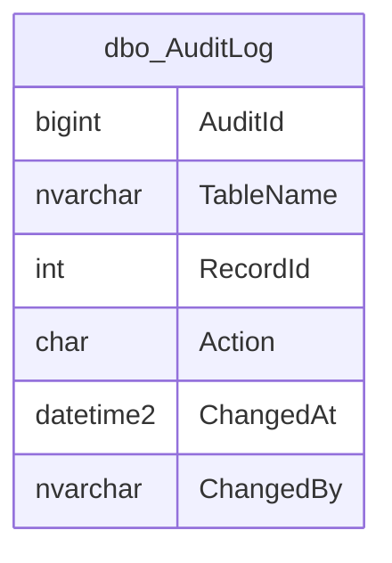

# dbo.AuditLog

Business area: [Audit and change tracking](../business-areas.md) · Source: [dbo.AuditLog.json](../../extracted/dbo.AuditLog.json) · [Database overview](../database-overview.md)

## Purpose

**Unknown:** the export has no stored description for this table or its columns.

**Inferred:** a technical change log. One row records that one row of another table was inserted (I), updated (U) or
deleted (D), with the time and the database login that made the change. The export shows that the triggers
`hr.trg_Employees_Audit` (on [hr.Employees](employees.md)) and `sales.trg_Orders_Audit` (on
[sales.Orders](orders.md)) write to it. The log records only that a row changed, not which values changed.

## Key facts

| Fact | Value |
|---|---|
| Schema | `dbo` |
| Type | Table (user table) |
| Object id | 1589580701 |
| Created | 2026-10-18 16:19:10.73 |
| Last modified | 2026-10-18 16:19:10.733 |
| Row count | 28 (from the system catalog's partition statistics; treat as an estimate) |
| Primary key | **None** (the table is stored as a heap, without a clustered index) |
| Other identifiers | None declared; `AuditId` is an identity column but has no key or unique constraint |
| Temporal (system-versioned) | No |
| Partitioned | No |
| Stored description | None |
| Extended properties | None |
| Columns | 6 |
| Columns flagged as sensitive by the export | 0 (but see `ChangedBy` below) |
| Triggers | None on this table; written by 2 triggers on other tables |
| Sample data | 28 of 28 rows (100 %), most recent first by `ChangedAt`, limit 100 rows; no values were masked |
| Profile | Full-table statistics for every column |

## Field guide

| # | Column | Data type | Nullable | Keys | Default | Meaning |
|---|---|---|---|---|---|---|
| 1 | `AuditId` | bigint | No | | Identity (1, 1) | Sequence number of the log entry, generated by the database (**inferred**). Not declared unique. |
| 2 | `TableName` | sysname (nvarchar(128)) | No | Indexed with `RecordId` | | Schema and name of the table whose row changed, for example `sales.Orders` (**inferred**). |
| 3 | `RecordId` | int | No | Indexed with `TableName` | | Number of the changed row in that table, for example an order or employee number (**inferred**). |
| 4 | `Action` | char(1) | No | | | Kind of change: I = insert, U = update, D = delete (**inferred** from the allowed values). |
| 5 | `ChangedAt` | datetime2(3) | No | | `sysutcdatetime()` | When the change was recorded, to the millisecond; UTC unless a value is supplied (**inferred**). |
| 6 | `ChangedBy` | sysname (nvarchar(128)) | No | | `suser_sname()` | The database login that made the change, filled automatically (**inferred**). |

**Confirmed structure:**

- Identity: `AuditId` is a 64-bit identity column starting at 1 and increasing by 1.
- `sysname` is the database's built-in type for object and login names; it is stored as `nvarchar(128)`.
- No computed, row-GUID, sparse or generated-always columns.
- Collation: `TableName`, `Action` and `ChangedBy` use `SQL_Latin1_General_CP1_CI_AS` (case-insensitive,
  accent-sensitive), so lower-case i, u or d would also pass the check on `Action`.
- No stored descriptions or sensitivity classifications.

**Sensitivity:** the export's name-based heuristic classifies no column as sensitive, so the sample was not masked.
However, `ChangedBy` holds real database login names, which identify people (and can reveal the organisation's
network domain). Treat it as personal data; its values are shown as `[hidden]` in this document.

## Relationships

There are no foreign keys to or from this table, and no inferred relationships are recorded.

- **Rejected candidate (polymorphic reference):** `TableName` plus `RecordId` points to a row in whichever table is
  named: an order number (`sales.Orders.OrderId`) when `TableName` is `sales.Orders`, and an employee number
  (`hr.Employees.EmployeeId`) when it is `hr.Employees`. One column cannot be a foreign key to several tables, so this
  is not a relationship. Joining `RecordId` to either table without also filtering on `TableName` gives wrong matches.
  Entries also stay after the original row is deleted (that is their purpose for D entries).
- **Rejected candidate:** `ChangedBy` and `hr.Employees.UserName`. `ChangedBy` holds a database login, which need not
  match an employee's application user name; nothing in the export links them.
- The triggers that write here are dependencies, not relationships. See [hr.Employees](employees.md) and
  [sales.Orders](orders.md).

## Constraints and defaults

| Constraint | Type | Column | Definition | In practice |
|---|---|---|---|---|
| `CK_AuditLog_Action` | Check (enabled, trusted) | `Action` | `([Action]='D' OR [Action]='U' OR [Action]='I')` | Only I, U or D can be stored. |
| `DF_AuditLog_ChangedAt` | Default | `ChangedAt` | `(sysutcdatetime())` | The current UTC date and time is filled in when the writer does not give one; the triggers rely on this. |
| `DF_AuditLog_ChangedBy` | Default | `ChangedBy` | `(suser_sname())` | The login of the session making the change is filled in automatically; the triggers rely on this. |

There is no primary key or unique constraint, so the database would accept duplicate `AuditId` values if identity
insertion were switched on.

## Indexes, triggers and dependencies

| Index | Type | Key columns | Included columns | Filter | Unique |
|---|---|---|---|---|---|
| `IX_AuditLog_Table_Record` | Nonclustered | `TableName`, `RecordId` | | | No |

- The index supports the typical question "what happened to this order (or employee)?". There is no clustered index,
  and no index on `ChangedAt`, so questions by time read the whole table.
- No triggers on this table.

**Objects that use the table (from the export's dependency list; dynamic SQL is not detected):**

- `hr.trg_Employees_Audit`: runs after updates and deletes of employees and writes one row per affected employee with
  `TableName` = `hr.Employees`, the employee number in `RecordId` and U or D in `Action`. It does not log new employees.
- `sales.trg_Orders_Audit`: writes rows with `TableName` = `sales.Orders`; the sample has insert (I) and update (U)
  entries for orders. Its definition belongs to [sales.Orders](orders.md).
- The check constraint `CK_AuditLog_Action`.

## Business rules

**Enforced by the database (confirmed structure):**

- Every entry has a table name, a row number, an action of I, U or D, a time and a login; time and login default to
  the current UTC time and the current login.

**Inferred (needs validation):**

- Entries are written only by the triggers and are never changed or deleted; nothing in the database prevents
  changing them.
- `RecordId` must always be read together with `TableName`; order numbers (from 1000) and employee numbers (from 100)
  come from separate counters and can overlap.
- `RecordId` is a whole number, so the log can only cover tables with a single whole-number key (for example not
  `sales.OrderItems`, whose key is the order number plus a line number).
- No retention rule is visible; the table grows with every change.

## Sample data and profile

The sample holds all 28 rows (100 % coverage, strategy: most recent first by `ChangedAt`, limit 100 rows,
deterministic). The export did not mask any column; login names in `ChangedBy` are replaced by `[hidden]` here. Three
example rows:

| `AuditId` | `TableName` | `RecordId` | `Action` | `ChangedAt` | `ChangedBy` |
|---|---|---|---|---|---|
| 1 | sales.Orders | 1006 | I | 2026-10-18 10:49:10.837 | [hidden] |
| 15 | hr.Employees | 103 | U | 2026-10-18 10:49:10.871 | [hidden] |
| 28 | sales.Orders | 1000 | U | 2026-10-18 10:49:10.966 | [hidden] |

**Reported profile (full table, 28 rows):**

- `AuditId`: 1 to 28, all distinct, no gaps.
- `TableName`: 2 values, always 12 characters: `sales.Orders` 21 times, `hr.Employees` 7 times.
- `RecordId`: 13 distinct values from 100 to 1006 (employee numbers 100 to 105 and order numbers 1000 to 1006).
- `Action`: U 21 times, I 7 times; no deletions (D) recorded.
- `ChangedAt`: only 5 distinct times, all on 2026-10-18 between 10:49:10.837 and 10:49:10.966.
- `ChangedBy`: one single login for all 28 rows.

**Observed sample:** each of the 7 orders has one insert and two update entries; each of the 6 employees has one
update entry and employee 103 has a second one. All entries were made within about a tenth of a second by one login,
which suggests the log reflects loading of test data rather than day-to-day business activity.

## Common uses

**Inferred:**

- Answering "who changed this order or employee, and when?", using `TableName` and `RecordId`.
- Showing that deleted orders or employees once existed (D entries).
- Counting changes per table, per day or per login for audit and compliance reports. Each entry is one changed row,
  not one business event: a single statement that updates 7 orders writes 7 entries.

## Diagram

How to read it: the box shows the table and its columns. It has no lines because no foreign key links it to another
table and no relationship is inferred; the triggers on `hr.Employees` and `sales.Orders` write to it, and it refers
back to their rows only through `TableName` and `RecordId`.

## Assumptions and questions

**Assumptions:**

- The table is written only by the two triggers; no other writer is visible in the export.
- `ChangedAt` is in UTC, because the default uses the UTC clock.

**Questions for the business:**

1. Should `AuditId` become the primary key (and a clustered index), so entries are guaranteed unique?
2. How long must audit entries be kept, and who may read them, given that `ChangedBy` identifies people?
3. Should the log also record new employees (inserts), and which values changed?
4. Should other tables, such as customers, products or order lines, also be audited?
5. Should audit entries be protected against changes and deletion?
