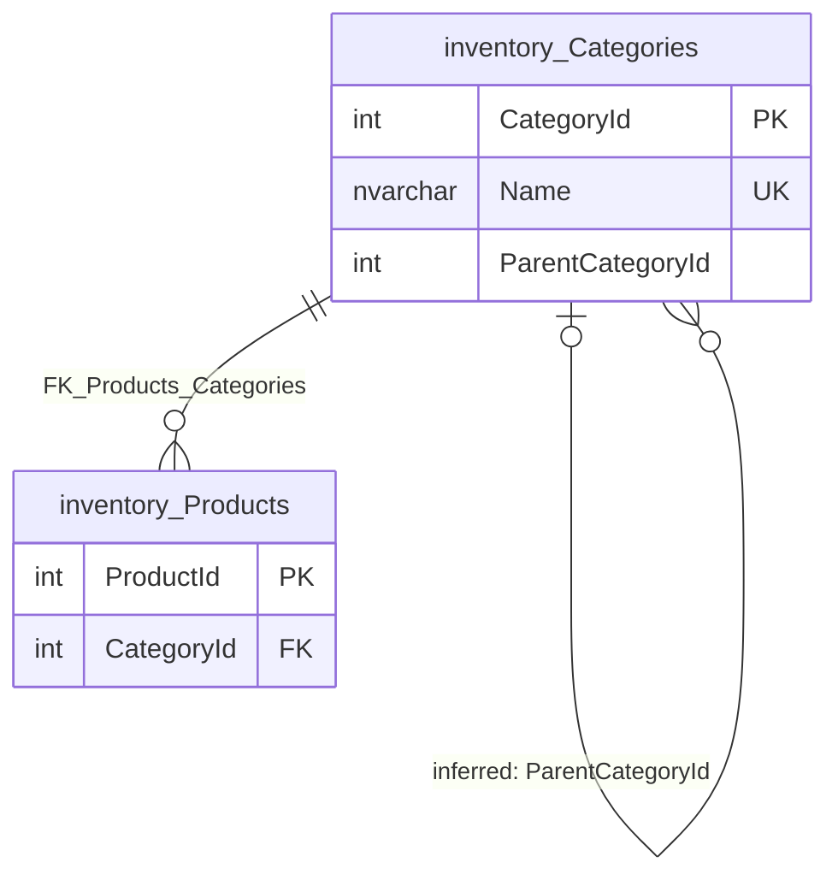

# inventory.Categories

Business area: [Products and inventory](../business-areas.md) · Source: [inventory.Categories.json](../../extracted/inventory.Categories.json) · [Database overview](../database-overview.md)

## Purpose

**Inferred:** the product categories used to classify [inventory.Products](products.md). One row is one category,
such as a main group or a sub-group. A category can sit under a parent category, so the categories form a tree
(for example a main group with several sub-groups beneath it). Every product must belong to exactly one category.

The export holds no stored description for the table, so this purpose is inferred from its columns, keys, the
foreign key from products and the sample.

## Key facts

| Fact | Value |
|---|---|
| Schema | `inventory` |
| Type | Table (user table) |
| Object id | 1189579276 |
| Created | 2026-10-18 16:19:10.693 |
| Last modified | 2026-10-18 16:19:10.707 |
| Row count | 5 (from the system catalog's partition statistics; treat as an estimate; the full-table profile also counted 5) |
| Primary key | `PK_Categories` on `CategoryId` (clustered) |
| Other identifiers | `Name` (unique constraint `UQ_Categories_Name`) |
| Temporal (system-versioned) | No |
| Partitioned | No |
| Stored description | None |
| Extended properties | None |
| Columns | 3 |
| Columns flagged as sensitive by the export | 0 |
| Sample data | 5 of 5 rows (100 %), most recently inserted first (by `CategoryId` descending), limit 100 rows; sanitization on, nothing needed masking |
| Profile | Full-table statistics for every column |

## Field guide

| # | Column | Data type | Nullable | Keys | Default | Meaning |
|---|---|---|---|---|---|---|
| 1 | `CategoryId` | int | No | PK, identity | | Number that identifies the category, assigned automatically by the database. |
| 2 | `Name` | nvarchar(100) | No | Unique (`UQ_Categories_Name`) | | Display name of the category, up to 100 characters (**inferred** meaning). |
| 3 | `ParentCategoryId` | int | Yes | | | The category this one sits under; empty for a top-level category (**inferred** link to `CategoryId` of this table; no foreign key). |

**Confirmed structure:**

- Identity: `CategoryId` starts at 1 and increases by 1 for each new category.
- Collation: `Name` uses `SQL_Latin1_General_CP1_CI_AS`, which ignores upper and lower case when comparing. The
  unique constraint therefore treats names that differ only in case as the same name.
- No computed, row-GUID, sparse or generated-always columns.
- No stored descriptions or classifications on any column.

**Sensitivity:** the export classifies no column as sensitive (category None for all three, by its name heuristic),
and the sample was not masked. That classification alone does not prove a value is safe to publish.

## Relationships

| Direction | Related table | Columns | Cardinality | Evidence | Rules |
|---|---|---|---|---|---|
| Incoming | [inventory.Products](products.md) | `Products.CategoryId` → `CategoryId` | One category to zero or more products; every product has exactly one category (required) | **Confirmed** foreign key `FK_Products_Categories`, enabled and trusted | On delete: no action; on update: no action |
| Outgoing (self) | inventory.Categories (this table) | `ParentCategoryId` → `CategoryId` | Many categories to zero or one parent category (optional) | **Inferred**, no foreign key | Not enforced |
| Incoming (self) | inventory.Categories (this table) | `CategoryId` ← `ParentCategoryId` | One category to zero or more sub-categories | **Inferred**, same link seen from the parent side | Not enforced |

- **Products:** a category that still has products cannot be deleted, and its `CategoryId` cannot be changed while
  products use it (no action rules). `CategoryId` is an identity column, so it is not normally changed anyway.
- **Parent category:** evidence for the self-link: the column name (`Parent` + `CategoryId`), the same type (`int`)
  as the primary key, the column is optional, and in the sample every filled value (1 and 4) is an existing
  `CategoryId`. Confidence: high. Because the link is not enforced, the database accepts a parent number that does
  not exist, a category that is its own parent, or a loop of categories. The column has no index, so finding the
  sub-categories of a category reads the whole table (unimportant at 5 rows).

## Constraints and defaults

| Name | Type | Column | Definition | In practice |
|---|---|---|---|---|
| `PK_Categories` | Primary key | `CategoryId` | Clustered, unique | Each category has its own number. |
| `UQ_Categories_Name` | Unique | `Name` | Nonclustered unique index | Two categories cannot have the same name, ignoring case. |

There are no check constraints and no default constraints. The foreign key `FK_Products_Categories` is defined on
[inventory.Products](products.md) and points to this table.

## Indexes, triggers and dependencies

**Indexes**

| Name | Type | Key columns | Included | Filter | Unique |
|---|---|---|---|---|---|
| `PK_Categories` | Clustered (primary key) | `CategoryId` ASC | none | none | Yes |
| `UQ_Categories_Name` | Nonclustered (unique constraint) | `Name` ASC | none | none | Yes |

- `PK_Categories` stores the rows in category-number order and serves look-ups by number, for example from products.
- `UQ_Categories_Name` enforces unique names and serves look-ups by name.

**Triggers:** none. Changes to categories are not written to the audit log.

**Used by:** the export lists no views, procedures or functions that use this table. The export notes that
references made through dynamic SQL are not detected.

## Business rules

**Enforced by the database:**

- Every category has a name of up to 100 characters.
- Category names are unique, ignoring upper and lower case.
- A category cannot be deleted while any product is classified in it.

**Inferred, needs validation:**

- Categories form a tree through `ParentCategoryId`; top-level categories have no parent. The database does not
  check that the parent exists or that the tree has no loops.
- The tree has two levels in the sample (**observed sample**): two top-level categories, each with sub-categories.
- Products may be classified at any level, not only in the lowest sub-category (**observed sample**: products are in
  sub-categories and in one top-level category; see [inventory.Products](products.md)).

## Sample data and profile

**Sampling:** the export read all 5 rows (100 % coverage, limit 100), most recently inserted first
(`CategoryId` descending). Sanitization was on; no column needed masking.

| `CategoryId` | `Name` | `ParentCategoryId` |
|---|---|---|
| 5 | Kitchen | 4 |
| 4 | Home | *(empty)* |
| 1 | Electronics | *(empty)* |

The remaining two rows are sub-categories Phones (2) and Laptops (3), both under Electronics (1).

**Reported profile (full table, 5 rows):**

| Column | Empty | Distinct | Observations |
|---|---|---|---|
| `CategoryId` | 0 | 5 | 1 to 5, no gaps. |
| `Name` | 0 | 5 | 4 to 11 characters, average 7. |
| `ParentCategoryId` | 2 (40 %) | 2 | 1 (2 categories) and 4 (1 category); the two empty rows are the top-level categories. |

## Common uses

**Inferred:**

- Classify products and build catalogue navigation (main group → sub-group).
- Report stock and sales by category, by joining to [inventory.Products](products.md) and from there to order lines.
- Look up a category by its unique name.

Counting pitfalls:

- Totals per top-level category must also include the products of its sub-categories; the database stores only the
  direct category of each product. Walk the tree before adding up.
- A product sits in exactly one category, so summing over leaf categories and a parent's own products does not
  count a product twice, but summing over every level of the tree does.

## Diagram

How to read it: `||--o{` means "exactly one on the left, zero or more on the right": every product belongs to
exactly one category, and a category can have no or many products. `|o--o{` means "zero or one on the left, zero or
more on the right": a category has at most one parent and can have no or many sub-categories. The self-link is
**inferred** (labelled "inferred"); the database does not enforce it.

## Assumptions and questions

**Assumptions**

- `ParentCategoryId` refers to `CategoryId` in this table, although no foreign key says so.
- Category names are meant for display to staff and customers.

**Questions for the business**

1. Should a foreign key be added from `ParentCategoryId` to `CategoryId`, so that a parent must exist and cannot be
   deleted while it has sub-categories?
2. How many levels may the category tree have, and are loops (a category under its own descendant) ruled out by the
   application?
3. May products be placed in a top-level category, or should they always go into the lowest sub-category?
4. Should changes to categories be recorded in the audit log?
