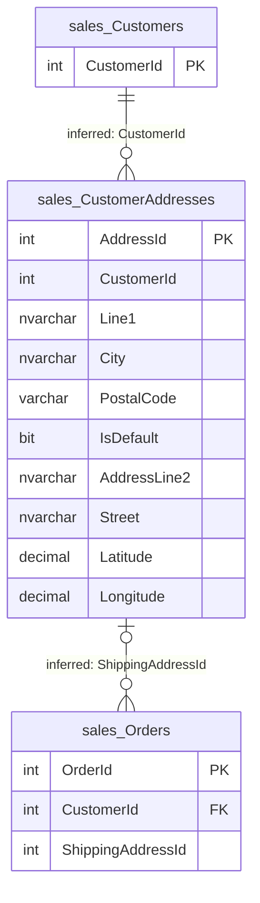

# sales.CustomerAddresses

Business area: [Sales](../business-areas.md) · Source: [sales.CustomerAddresses.json](../../extracted/sales.CustomerAddresses.json) · [Database overview](../database-overview.md)

## Purpose

**Inferred:** the postal addresses of customers. One row is one address of one customer, with address lines, city,
postal code, map coordinates and a flag that marks the customer's default address. A customer can have several
addresses, at most one of them the default. Orders in [sales.Orders](orders.md) appear to use these addresses as
shipping addresses.

The export holds no stored description for the table, so this purpose is inferred from its columns, indexes and
sample.

## Key facts

| Fact | Value |
|---|---|
| Schema | `sales` |
| Type | Table (user table) |
| Object id | 1141579105 |
| Created | 2026-10-18 16:19:10.687 |
| Last modified | 2026-10-18 16:19:10.887 |
| Row count | 7 (from the system catalog's partition statistics; treat as an estimate) |
| Primary key | `PK_CustomerAddresses` on `AddressId` (clustered) |
| Other identifiers | Filtered unique index `UX_CustomerAddresses_Default` on `CustomerId` where `IsDefault` = 1 |
| Temporal (system-versioned) | No |
| Partitioned | No |
| Stored description | None |
| Extended properties | None |
| Columns | 10 |
| Columns flagged as sensitive by the export | 5 (`PostalCode`, `AddressLine2`, `Street`, `Latitude`, `Longitude`) |
| Sample data | 7 of 7 rows (100 %), most recently inserted first by `AddressId`, limit 100 rows; sensitive values masked |
| Profile | Full-table statistics for every column |

## Field guide

| # | Column | Data type | Nullable | Keys | Default | Meaning |
|---|---|---|---|---|---|---|
| 1 | `AddressId` | int | No | PK | Identity (1, 1) | Internal number that identifies the address. Generated by the database. |
| 2 | `CustomerId` | int | No | Indexed; unique among default addresses | | The customer the address belongs to (**inferred** link to [sales.Customers](customers.md); no foreign key). |
| 3 | `Line1` | nvarchar(200) | No | | | First address line, such as house number and street or area (**inferred** from sample values). |
| 4 | `City` | nvarchar(100) | No | | | City of the address (**inferred**). |
| 5 | `PostalCode` | varchar(12) | No | | | Postal code of the address (**inferred**). |
| 6 | `IsDefault` | bit | No | | `0` | Yes/no flag: this is the customer's default address (**inferred**). New addresses are not the default unless set. |
| 7 | `AddressLine2` | nvarchar(200) | Yes | | | Optional second address line (**inferred**). |
| 8 | `Street` | nvarchar(120) | Yes | | | Street name (**inferred**); may overlap with `Line1`. |
| 9 | `Latitude` | decimal(9,6) | Yes | | | Map latitude of the address in decimal degrees, six decimals (**inferred**). |
| 10 | `Longitude` | decimal(9,6) | Yes | | | Map longitude of the address in decimal degrees, six decimals (**inferred**). |

**Confirmed structure:**

- Identity: `AddressId` is an identity column starting at 1 and increasing by 1.
- No computed, row-GUID, sparse or generated-always columns.
- Collation: the text columns use `SQL_Latin1_General_CP1_CI_AS` (case-insensitive, accent-sensitive).
- No stored descriptions or classifications on any column.

**Sensitivity (export heuristic, based on column names):** `PostalCode`, `AddressLine2` and `Street` (postal
address) and `Latitude` and `Longitude` (location) were masked in the sample. `Line1` and `City` are classified as
not sensitive, but `Line1` holds street addresses in the sample and must be treated as personal data.

## Relationships

| Direction | Related table | Columns | Cardinality | Evidence | Rules |
|---|---|---|---|---|---|
| Outgoing | [sales.Customers](customers.md) | `CustomerId` → `Customers.CustomerId` | Many addresses to one customer; every address has a customer number | **Inferred**, no foreign key | Not enforced |
| Incoming | [sales.Orders](orders.md) | `Orders.ShippingAddressId` → `AddressId` | One address can be used by zero or many orders; an order has at most one shipping address | **Inferred**, no foreign key | Not enforced |

- **Customer link:** same column name and type (`int`) as the customers' primary key, an index on `CustomerId`, and
  the "one default address per customer" index only makes sense per customer. In the sample, the 7 addresses refer
  to customers 1 to 6, all of which exist. Confidence: high.
- **Order link:** `Orders.ShippingAddressId` has the same type (`int`) and names an address; in the sample all 7
  orders point to an existing address, and each order's address belongs to the same customer as the order.
  Confidence: high, but the database checks neither that the address exists nor that it belongs to the ordering
  customer.
- The export lists no foreign keys for this table in either direction.

## Constraints and defaults

| Name | Type | Column | Definition | In practice |
|---|---|---|---|---|
| `PK_CustomerAddresses` | Primary key | `AddressId` | Clustered, unique | Each address number appears once. |
| `DF_CustomerAddresses_IsDefault` | Default | `IsDefault` | `((0))` | A new address is not the default unless stated. |

There are no check or unique constraints. The "one default per customer" rule is enforced by a unique index (below).

## Indexes, triggers and dependencies

**Indexes**

| Name | Type | Key columns | Included | Filter | Unique |
|---|---|---|---|---|---|
| `PK_CustomerAddresses` | Clustered (primary key) | `AddressId` ASC | none | none | Yes |
| `UX_CustomerAddresses_Default` | Nonclustered | `CustomerId` ASC | none | `([IsDefault]=(1))` | Yes |
| `IX_CustomerAddresses_CustomerId` | Nonclustered | `CustomerId` ASC | none | none | No |

- `UX_CustomerAddresses_Default` allows only one row with `IsDefault` = 1 per customer; any number of non-default
  addresses is allowed.
- `IX_CustomerAddresses_CustomerId` speeds up finding all addresses of a customer.

**Triggers:** none.

**Used by:** the export lists no views, procedures, functions or constraints that depend on this table.

## Business rules

**Enforced by the database:**

- Every address has a customer number, a first line, a city, a postal code and a default flag.
- A customer can have at most one default address.
- Coordinates, if given, have up to three digits before and six after the decimal point.

**Inferred, needs validation:**

- Each address belongs to an existing customer (not enforced; holds in the sample).
- Each customer should have exactly one default address: in the sample, 6 of the 7 addresses are defaults, one per
  customer, and customer 1 has a second, non-default address (**observed sample**). The database does not require a
  default to exist.
- Orders ship to an address of the ordering customer (holds for all 7 orders in the sample, not enforced).

## Sample data and profile

**Sampling:** the export read all 7 rows (100 % coverage, limit 100), most recently inserted first by `AddressId`.
Sensitive columns were masked; values marked `[hidden]` are masked or removed here.

| `AddressId` | `CustomerId` | `Line1` | `City` | `PostalCode` | `IsDefault` | `AddressLine2` | `Street` | `Latitude` | `Longitude` |
|---|---|---|---|---|---|---|---|---|---|
| 7 | 6 | [hidden] | Chennai | [hidden] | true | [hidden] | [hidden] | [hidden] | [hidden] |
| 2 | 1 | [hidden] | Delhi | [hidden] | false | (empty) | [hidden] | [hidden] | [hidden] |
| 1 | 1 | [hidden] | Delhi | [hidden] | true | [hidden] | [hidden] | [hidden] | [hidden] |

**Reported profile (full table, 7 rows):**

| Column | Empty | Distinct | Observations |
|---|---|---|---|
| `AddressId` | 0 | 7 | 1 to 7, no gaps. |
| `CustomerId` | 0 | 6 | Customers 1 to 6; customer 1 has two addresses, the others one each. |
| `Line1` | 0 | 7 | Length 10 to 15 characters, average 12.43. |
| `City` | 0 | 6 | Delhi 2; Bengaluru, Chennai, Jaipur, Kolkata and Mumbai 1 each; length 5 to 9. |
| `PostalCode` | 0 | 7 | All different. |
| `IsDefault` | 0 | 2 in the sample | true 6, false 1. |
| `AddressLine2` | 3 (42.86 %) | 4 | Filled values all different. |
| `Street` | 0 | 7 | Always filled although optional; all different. |
| `Latitude` | 0 | 7 | Always filled although optional; all different. |
| `Longitude` | 0 | 7 | Always filled although optional; all different. |

## Common uses

**Inferred:**

- Choose the shipping address when an order is taken, normally the customer's default address.
- Print delivery labels and plan deliveries, using the coordinates for routing or maps.
- Report customers or orders by city.

Counting pitfall: count customers from [sales.Customers](customers.md), not from this table; a customer can have
several addresses, and a customer without an address does not appear here.

## Diagram

How to read it: `||--o{` means "exactly one on the left, zero or more on the right": each address belongs to one
customer, who can have no or many addresses. `|o--o{` means "zero or one on the left": an order has at most one
shipping address, and an address can be used by no or many orders. Both lines are **inferred** (labelled
"inferred"); the database has no foreign keys for them.

## Assumptions and questions

**Assumptions**

- `CustomerId` refers to `sales.Customers` and `ShippingAddressId` in `sales.Orders` refers to `AddressId`, although
  no foreign key says so.
- `Line1` and `Street` overlap: both hold street information.

**Questions for the business**

1. Should foreign keys be added from `CustomerId` to `sales.Customers` and from `sales.Orders.ShippingAddressId` to
   this table?
2. What is the difference between `Line1`, `Street` and `AddressLine2`? Which should be printed on a label?
3. Must every customer have exactly one default address?
4. When an address changes, is the row updated or a new row added? Updating it would change the shipping address of
   past orders.
5. Is there a country for the addresses? The table has no country column.
6. Where do the coordinates come from, and should `Line1` be classified as sensitive like the other address columns?
