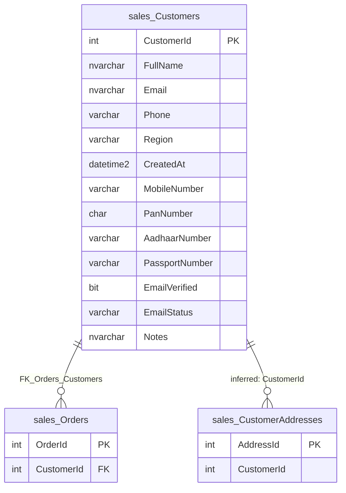

# sales.Customers

Business area: [Sales](../business-areas.md) · Source: [sales.Customers.json](../../extracted/sales.Customers.json) · [Database overview](../database-overview.md)

## Purpose

**Confirmed structure:** the table's stored description reads "People and companies that buy from us."

One row is one customer: a person or company that buys from the business, with contact details (email, phone,
mobile), a sales region, identity document numbers, an email verification state and free-text notes.
**Inferred:** the customer is the starting point of the sales process; orders in [sales.Orders](orders.md) are placed
by a customer, and the customer's postal addresses are kept in [sales.CustomerAddresses](customeraddresses.md).

## Key facts

| Fact | Value |
|---|---|
| Schema | `sales` |
| Type | Table (user table) |
| Object id | 1077578877 |
| Created | 2026-10-18 16:19:10.683 |
| Last modified | 2026-10-18 16:19:10.900 |
| Row count | 6 (from the system catalog's partition statistics; treat as an estimate) |
| Primary key | `PK_Customers` on `CustomerId` (clustered) |
| Other identifiers | Filtered unique index `UX_Customers_Email` on `Email` (only where `Email` is filled) |
| Temporal (system-versioned) | No |
| Partitioned | No |
| Stored description | "People and companies that buy from us." |
| Extended properties | None besides the description |
| Columns | 13 |
| Columns flagged as sensitive by the export | 7 (`FullName`, `Email`, `Phone`, `MobileNumber`, `PanNumber`, `AadhaarNumber`, `PassportNumber`) |
| Sample data | 6 of 6 rows (100 %), most recent first by `CreatedAt`, limit 100 rows; sensitive values masked |
| Profile | Full-table statistics for every column |

## Field guide

| # | Column | Data type | Nullable | Keys | Default | Meaning |
|---|---|---|---|---|---|---|
| 1 | `CustomerId` | int | No | PK | Identity (1, 1) | Internal number that identifies the customer. Generated by the database. |
| 2 | `FullName` | nvarchar(120) | No | | | Name of the customer, person or company (**inferred**). |
| 3 | `Email` | nvarchar(256) | Yes | Unique when filled | | Customer's email address (**inferred**). Two customers cannot share the same email. |
| 4 | `Phone` | varchar(20) | Yes | | | Customer's phone number (**inferred**), stored as text. |
| 5 | `Region` | varchar(10) | No | | | Sales region used for reporting (**stored description**). Only `North`, `East`, `South` or `West` are allowed. |
| 6 | `CreatedAt` | datetime2(0) | No | | `sysutcdatetime()` | When the customer record was created, in UTC to the whole second (**inferred** from the default). |
| 7 | `MobileNumber` | varchar(20) | Yes | | | Customer's mobile number, separate from `Phone` (**inferred**). |
| 8 | `PanNumber` | char(10) | Yes | | | A government tax or identity number (PAN) of the customer, fixed at 10 characters (**inferred** from the name). |
| 9 | `AadhaarNumber` | varchar(14) | Yes | | | A national identity number (Aadhaar) of the customer (**inferred** from the name). |
| 10 | `PassportNumber` | varchar(12) | Yes | | | The customer's passport number (**inferred**). |
| 11 | `EmailVerified` | bit | Yes | | | Yes/no flag: whether the email address has been verified (**inferred**). |
| 12 | `EmailStatus` | varchar(12) | Yes | | | Text status of the email verification, such as Verified or Pending (**inferred** from sample values). |
| 13 | `Notes` | nvarchar(400) | Yes | | | Free-text remarks about the customer (**inferred**). |

**Confirmed structure:**

- Identity: `CustomerId` is an identity column starting at 1 and increasing by 1.
- No computed, row-GUID, sparse or generated-always columns.
- Collation: all text columns use `SQL_Latin1_General_CP1_CI_AS` (case-insensitive, accent-sensitive).
- Stored descriptions: only `Region` has one ("Sales region used for reporting.").
- Stored classification: `Region` carries the database's own sensitivity label "Public"; no other column has one.

**Sensitivity (export heuristic, based on column names):** `FullName` (person name), `Email` (contact email),
`Phone` and `MobileNumber` (contact phone), `PanNumber`, `AadhaarNumber` and `PassportNumber` (government
identifier). All seven were masked in the sample. `Notes` is classified as not sensitive, yet the export's free-text
scrubbing removed 7 pieces of sensitive content from it (see Sample data and profile); treat `Notes` as sensitive.

## Relationships

| Direction | Related table | Columns | Cardinality | Evidence | Rules |
|---|---|---|---|---|---|
| Incoming | [sales.Orders](orders.md) | `Orders.CustomerId` → `CustomerId` | One customer has zero or many orders; every order has exactly one customer | **Confirmed** foreign key `FK_Orders_Customers`, enabled and trusted | On delete: no action; on update: no action |
| Incoming | [sales.CustomerAddresses](customeraddresses.md) | `CustomerAddresses.CustomerId` → `CustomerId` | One customer has zero or many addresses; each address belongs to one customer | **Inferred**, no foreign key | Not enforced |

- `FK_Orders_Customers` with "no action" means a customer who still has orders cannot be deleted, and
  `CustomerId` cannot be changed while orders refer to it.
- The address link is inferred from the matching column name and type (`int`), the index on
  `CustomerAddresses.CustomerId`, the unique "one default address per customer" index, and the sample: all 7
  address rows refer to customer numbers 1 to 6, which all exist here. Because it is not enforced, an address can
  refer to a customer that does not exist, and deleting a customer does not remove its addresses.
- The table has no outgoing relationships.

## Constraints and defaults

| Name | Type | Column | Definition | In practice |
|---|---|---|---|---|
| `PK_Customers` | Primary key | `CustomerId` | Clustered, unique | Each customer number appears once. |
| `CK_Customers_Region` | Check (enabled, trusted) | `Region` | `([Region]='West' OR [Region]='East' OR [Region]='South' OR [Region]='North')` | Region must be one of the four compass regions; other values are rejected. |
| `DF_Customers_CreatedAt` | Default | `CreatedAt` | `(sysutcdatetime())` | When no value is given, the current UTC date and time is stored. |

No unique constraints are declared; email uniqueness comes from the filtered unique index below.

## Indexes, triggers and dependencies

**Indexes**

| Name | Type | Key columns | Included | Filter | Unique |
|---|---|---|---|---|---|
| `PK_Customers` | Clustered (primary key) | `CustomerId` ASC | none | none | Yes |
| `UX_Customers_Email` | Nonclustered | `Email` ASC | none | `([Email] IS NOT NULL)` | Yes |

`UX_Customers_Email` makes every filled email unique while allowing any number of customers without an email. It
also speeds up looking up a customer by email.

**Triggers:** none.

**Used by:**

- View `sales.vw_OrderSummary` reads this table (columns not listed by the export).
- Check constraint `CK_Customers_Region` uses `Region` (a constraint dependency, not a relationship).

The export notes that references made through dynamic SQL are not detected.

## Business rules

**Enforced by the database:**

- Every customer has a name (`FullName`), a region (`Region`) and a creation time (`CreatedAt`).
- `Region` is one of North, East, South or West.
- No two customers share the same filled `Email`.
- A customer cannot be deleted while orders refer to it (`FK_Orders_Customers`, no action).

**Inferred, needs validation:**

- `EmailVerified` and `EmailStatus` record the same thing in two forms: in the sample every "yes" goes with
  Verified, every "no" with Pending and both are empty together (**observed sample**, 6 rows). Nothing enforces
  this.
- Identity document numbers (`PanNumber`, `AadhaarNumber`, `PassportNumber`) are optional; customers can have any
  combination of them (**observed sample**).
- `Region` drives regional sales reporting (**stored description**).

## Sample data and profile

**Sampling:** the export read all 6 rows (100 % coverage, limit 100), newest first by `CreatedAt`, then by
`CustomerId` descending. Sensitive columns were masked; values marked `[hidden]` below are masked or removed here.
Free text in `Notes` is not shown because it held sensitive content.

| `CustomerId` | `FullName` | `Email` | `Phone` | `Region` | `CreatedAt` | `MobileNumber` | `PanNumber` | `AadhaarNumber` | `PassportNumber` | `EmailVerified` | `EmailStatus` | `Notes` |
|---|---|---|---|---|---|---|---|---|---|---|---|---|
| 6 | [hidden] | (empty) | (empty) | South | 2026-10-18 10:49:11 | (empty) | (empty) | (empty) | (empty) | (empty) | (empty) | [hidden] |
| 5 | [hidden] | [hidden] | [hidden] | North | 2026-10-18 10:49:11 | [hidden] | [hidden] | [hidden] | [hidden] | true | Verified | [hidden] |
| 2 | [hidden] | (empty) | [hidden] | South | 2026-10-18 10:49:11 | [hidden] | [hidden] | [hidden] | (empty) | false | Pending | [hidden] |

**Reported profile (full table, 6 rows):**

| Column | Empty | Distinct | Observations |
|---|---|---|---|
| `CustomerId` | 0 | 6 | 1 to 6, no gaps. |
| `FullName` | 0 | 6 | All different. |
| `Email` | 2 (33.33 %) | 4 | Filled values all different. |
| `Phone` | 2 (33.33 %) | 4 | Filled values all different. |
| `Region` | 0 | 4 | North 2, South 2, East 1, West 1; length 4 to 5. |
| `CreatedAt` | 0 | 1 | Every row has the same time, 2026-10-18 10:49:11, so the rows were loaded together. |
| `MobileNumber` | 2 (33.33 %) | 4 | Filled values all different. |
| `PanNumber` | 1 (16.67 %) | 5 | Filled values all different. |
| `AadhaarNumber` | 2 (33.33 %) | 4 | Filled values all different. |
| `PassportNumber` | 3 (50 %) | 3 | Filled values all different. |
| `EmailVerified` | 2 (33.33 %) | 2 in the sample | true 3, false 1. |
| `EmailStatus` | 2 (33.33 %) | 2 | Verified 3, Pending 1; length 7 to 8. |
| `Notes` | 0 | 6 | Length 2 to 105 characters, average 65. The export redacted 7 pieces of sensitive content in 4 of the 6 rows: an access token, an IP address, a password, a card number, a national identity number, a phone number and an email address. |

**Observed sample:** customer 2 has no email but an email status of Pending and `EmailVerified` set to false.

## Common uses

**Inferred:**

- Look up a customer, for example by email (supported by the unique email index), when taking or servicing an
  order.
- Group customers and their orders by `Region` for regional sales reports (via `sales.vw_OrderSummary` or by
  joining [sales.Orders](orders.md)).
- Find a customer's delivery address through [sales.CustomerAddresses](customeraddresses.md).
- Check whether a customer's email is verified before sending messages.
- Identity checks for customers who must provide a government identity document.

Counting pitfall: count customers from this table, not from orders; a customer with two orders appears twice in
`sales.Orders`, and customers without orders do not appear there at all.

## Diagram

How to read it: each box is a table, with the key columns of the neighbouring tables. `||--o{` means "exactly one
on the left, zero or more on the right": every order belongs to exactly one customer, and a customer can have no
orders or many. The line to `sales_CustomerAddresses` is **inferred** (labelled "inferred"); the database does not
enforce it.

## Assumptions and questions

**Assumptions**

- `PanNumber`, `AadhaarNumber` and `PassportNumber` hold government identity document numbers, as their names and
  the export's heuristic suggest.
- `CreatedAt` is in UTC, because its default uses the UTC clock; values supplied by an application may differ.
- The row count of 6 matches the sample, but catalog counts are estimates.

**Questions for the business**

1. Why do customers need PAN, Aadhaar and passport numbers, and who may see them? Storing three identity numbers
   per customer needs a legal basis and protection.
2. `Notes` contained an access token, a password, a card number and a national identity number. Should free-text
   notes be cleaned and staff told not to record such data?
3. Are `EmailVerified` and `EmailStatus` meant to be the same information? Which one is authoritative, and which
   other statuses exist besides Verified and Pending?
4. How can a customer without an email address have an email status of Pending?
5. What is the difference between `Phone` and `MobileNumber`?
6. Should the link from `sales.CustomerAddresses` to customers be enforced with a foreign key?
7. Is the customer a person or a company in each case? The table has no column that says which.
