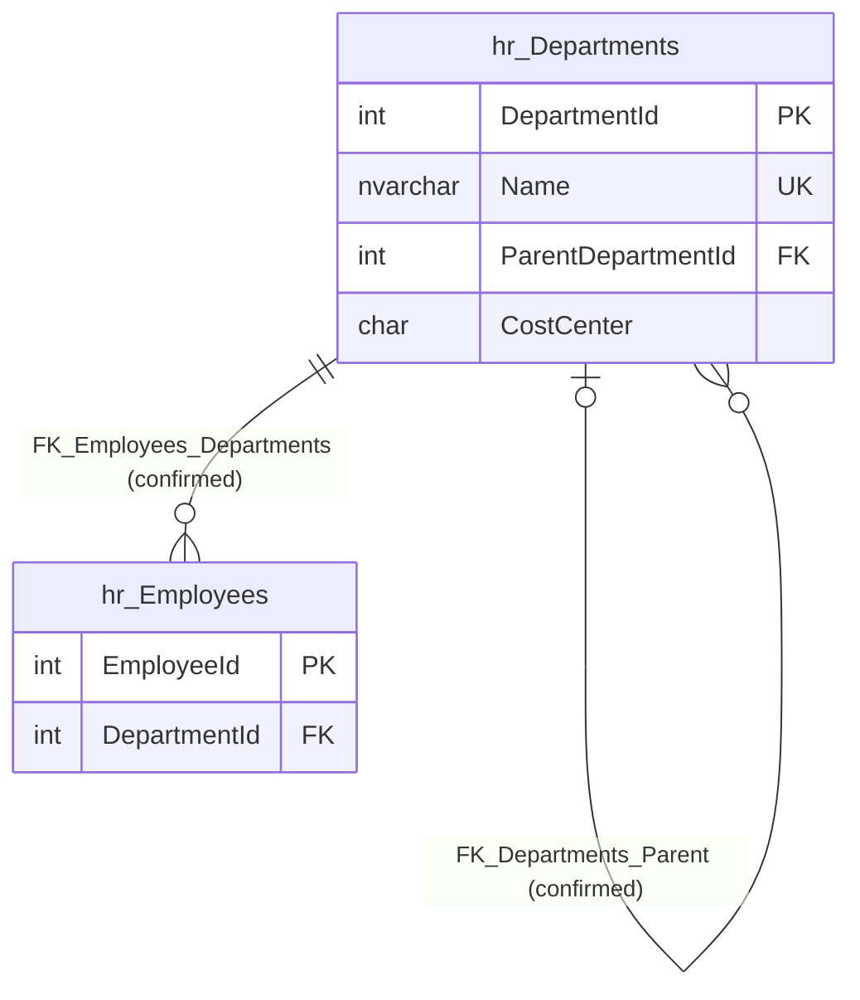

# hr.Departments

Business area: [Human resources](../business-areas.md) · Source: [hr.Departments.json](../../extracted/hr.Departments.json) · [Database overview](../database-overview.md)

## Purpose

**Confirmed structure:** the table's stored description reads "Organisational units. A department can sit under a
parent department."

One row is one organisational unit: its name, the cost centre its costs are booked to and, optionally, the department
it sits under. **Inferred:** the parent link builds the organisation chart (for example a team inside a larger
department), and [hr.Employees](employees.md) uses the table to say where each employee works.

## Key facts

| Fact | Value |
|---|---|
| Schema | `hr` |
| Type | Table (user table) |
| Object id | 901578250 |
| Created | 2026-10-18 16:19:10.67 |
| Last modified | 2026-10-18 16:19:10.68 |
| Row count | 5 (from the system catalog's partition statistics; treat as an estimate) |
| Primary key | `PK_Departments` on `DepartmentId` (clustered) |
| Other identifiers | Unique constraint `UQ_Departments_Name` on `Name` |
| Temporal (system-versioned) | No |
| Partitioned | No |
| Stored description | "Organisational units. A department can sit under a parent department." |
| Extended properties | None besides the description |
| Columns | 4 |
| Columns flagged as sensitive by the export | 0 |
| Triggers | None |
| Sample data | 5 of 5 rows (100 %), most recently inserted first by `DepartmentId`, limit 100 rows; no values needed masking |
| Profile | Full-table statistics for every column |

## Field guide

| # | Column | Data type | Nullable | Keys | Default | Meaning |
|---|---|---|---|---|---|---|
| 1 | `DepartmentId` | int | No | PK | Identity (1, 1) | Department number, generated by the database starting at 1 (**inferred** meaning). |
| 2 | `Name` | nvarchar(100) | No | Unique (`UQ_Departments_Name`) | | Name of the department, up to 100 characters; no two departments can share a name (**inferred** meaning). |
| 3 | `ParentDepartmentId` | int | Yes | FK → `hr.Departments.DepartmentId` | | The department this one sits under; empty for a top-level department (**inferred** meaning). |
| 4 | `CostCenter` | char(6) | No | | | Cost centre code, always "CC" followed by four digits (**inferred** meaning; the format is enforced). |

**Confirmed structure:**

- Identity: `DepartmentId` is an identity column starting at 1 and increasing by 1.
- No computed, row-GUID, sparse or generated-always columns.
- Collation: `Name` and `CostCenter` use `SQL_Latin1_General_CP1_CI_AS` (case-insensitive, accent-sensitive), so the
  uniqueness of `Name` ignores upper and lower case.
- `CostCenter` is fixed-length text of exactly 6 characters.
- No column has a stored description or a stored sensitivity classification.

**Sensitivity (export heuristic, based on column names):** no column is classified as sensitive. That does not prove
the values are safe to publish, but department names and cost centre codes are organisational, not personal, data.

## Relationships

| Direction | Related table | Columns | Cardinality | Evidence | Rules |
|---|---|---|---|---|---|
| Outgoing (self) | [hr.Departments](departments.md) | `ParentDepartmentId` → `Departments.DepartmentId` | Many departments to zero or one parent department | **Confirmed** foreign key `FK_Departments_Parent`, enabled and trusted | On delete: no action; on update: no action |
| Incoming (self) | [hr.Departments](departments.md) | `Departments.ParentDepartmentId` → `DepartmentId` | One department has zero or many sub-departments | **Confirmed** foreign key `FK_Departments_Parent`, enabled and trusted | On delete: no action; on update: no action |
| Incoming | [hr.Employees](employees.md) | `Employees.DepartmentId` → `DepartmentId` | One department has zero or many employees; every employee has exactly one department | **Confirmed** foreign key `FK_Employees_Departments`, enabled and trusted | On delete: no action; on update: no action |

- **Parent department:** a parent must be an existing department. Because the rule is "no action", a department
  cannot be deleted while another department sits under it.
- **Employees:** every employee must be in an existing department, and a department cannot be deleted while it has
  employees.
- No inferred relationships without a foreign key involve this table.

## Constraints and defaults

| Constraint | Type | Column | Definition | In practice |
|---|---|---|---|---|
| `PK_Departments` | Primary key (clustered) | `DepartmentId` | | Each department has one unique number; rows are stored in that order. |
| `UQ_Departments_Name` | Unique | `Name` | | Two departments cannot have the same name, ignoring case. |
| `FK_Departments_Parent` | Foreign key | `ParentDepartmentId` | References `hr.Departments.DepartmentId` | The parent must exist. |
| `CK_Departments_CostCenter` | Check (enabled, trusted) | `CostCenter` | `([CostCenter] like 'CC[0-9][0-9][0-9][0-9]')` | The code must be "CC" plus four digits. Because the column's collation ignores case, lower-case "cc" would also pass. |

There are no default constraints: every value except the generated `DepartmentId` must be supplied.

## Indexes, triggers and dependencies

| Index | Type | Key columns | Included columns | Filter | Unique |
|---|---|---|---|---|---|
| `PK_Departments` | Clustered | `DepartmentId` | | | Yes (primary key) |
| `UQ_Departments_Name` | Nonclustered | `Name` | | | Yes (unique constraint) |

- `ParentDepartmentId` has no index of its own, so finding the sub-departments of a department reads the whole table
  (unimportant at 5 rows).
- No triggers.
- Dependencies: only the check constraint `CK_Departments_CostCenter` refers to the table. No view, procedure or
  function uses it according to the export (references in dynamic SQL are not detected).

## Business rules

**Enforced by the database (confirmed structure):**

- Every department has a name, unique regardless of case, and a cost centre code of the form CC plus four digits.
- A parent department must exist; a department with sub-departments or employees cannot be deleted.

**Inferred (needs validation):**

- The departments form one tree with a single top-level unit (Head Office in the sample). Nothing prevents several
  top-level departments, or a loop such as a department being its own parent.
- Each department has its own cost centre: all 5 codes are different in the full-table profile, but the database does
  not require cost centres to be unique.

## Sample data and profile

The sample holds all 5 rows (100 % coverage, strategy: most recently inserted first by `DepartmentId`, limit 100 rows,
deterministic). No values were masked. Three example rows:

| `DepartmentId` | `Name` | `ParentDepartmentId` | `CostCenter` |
|---|---|---|---|
| 1 | Head Office | (empty) | CC1000 |
| 2 | Sales | 1 | CC2000 |
| 3 | Inside Sales | 2 | CC2100 |

**Reported profile (full table, 5 rows):**

- `DepartmentId`: 1 to 5, no gaps, all distinct.
- `Name`: all distinct, 5 to 12 characters (average 8.8).
- `ParentDepartmentId`: 1 empty (the top-level department); the other 4 point to department 1 (3 times) or 2 (once).
- `CostCenter`: all distinct, always 6 characters.

**Observed sample:** the structure is Head Office at the top, with Sales, Warehouse and Finance under it, and Inside
Sales under Sales. Cost centre codes follow the hierarchy loosely (CC2100 under CC2000).

## Common uses

**Inferred:**

- Organisation charts and lists of departments with their cost centres.
- Headcount and cost reports by department, joined from [hr.Employees](employees.md), and rolled up through
  `ParentDepartmentId` to higher-level units.
- Allocating employee costs to cost centres.

## Diagram

How to read it: each box is a table (only key columns are shown for `hr_Employees`). `||` means exactly one, `|o`
zero or one, and `o{` zero or many. A department has zero or one parent department and zero or many
sub-departments; a department has zero or many employees, and each employee belongs to exactly one department. Both
links are enforced by foreign keys.

## Assumptions and questions

**Assumptions:**

- `CostCenter` is a finance cost centre code; the export does not describe it.
- The hierarchy is meant to be a single tree without loops.

**Questions for the business:**

1. Should cost centre codes be unique per department, and should lower-case codes be rejected?
2. Can there be more than one top-level department, and how deep may the hierarchy go?
3. When a department is closed, is it deleted (only possible once it has no employees or sub-departments) or kept?
   There is no column to mark a department as inactive.
