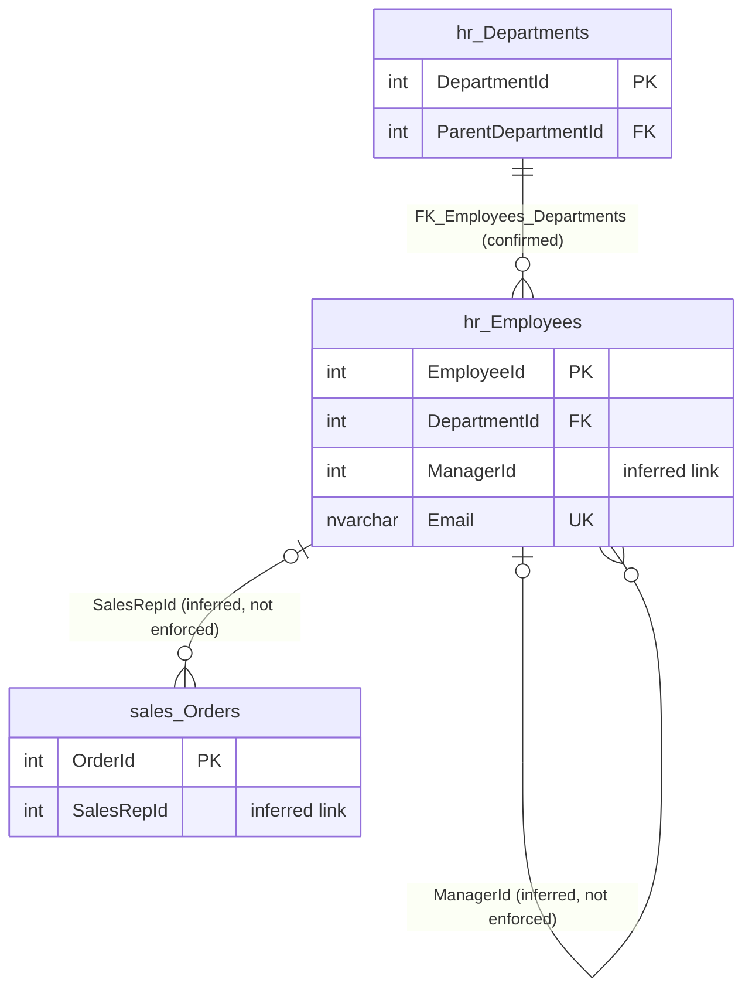

# hr.Employees

Business area: [Human resources](../business-areas.md) · Source: [hr.Employees.json](../../extracted/hr.Employees.json) · [Database overview](../database-overview.md)

## Purpose

**Confirmed structure:** the table's stored description reads "People employed by the company, including sales
representatives."

One row is one employee: the department they work in, their line manager, name and contact details, date of birth,
hire date and active flag, pay, and the details they use to sign in (user name, password hash, second-factor secret,
PIN, last sign-in address and device). **Inferred:** besides being the staff register, the table serves as the user
account store of an application, and employees named on orders as sales representatives come from here.

## Key facts

| Fact | Value |
|---|---|
| Schema | `hr` |
| Type | Table (user table) |
| Object id | 981578535 |
| Created | 2026-10-18 16:19:10.677 |
| Last modified | 2026-10-18 16:19:10.897 |
| Row count | 6 (from the system catalog's partition statistics; treat as an estimate) |
| Primary key | `PK_Employees` on `EmployeeId` (clustered) |
| Other identifiers | Unique constraint `UQ_Employees_Email` on `Email` |
| Temporal (system-versioned) | No |
| Partitioned | No |
| Stored description | "People employed by the company, including sales representatives." |
| Extended properties | None besides descriptions |
| Columns | 18 |
| Columns flagged as sensitive by the export | 12 (see Field guide) |
| Triggers | 1 (`trg_Employees_Audit`) |
| Sample data | 6 of 6 rows (100 %), most recent first by `HireDate` then `EmployeeId`, limit 100 rows; sensitive values masked, credential columns not read |
| Profile | Full-table statistics for every column that was read; none for the three credential columns |

## Field guide

| # | Column | Data type | Nullable | Keys | Default | Meaning |
|---|---|---|---|---|---|---|
| 1 | `EmployeeId` | int | No | PK | Identity (100, 1) | Employee number, generated by the database starting at 100 (**inferred** meaning). |
| 2 | `DepartmentId` | int | No | FK → `hr.Departments.DepartmentId` | | The department the employee works in (**inferred** meaning). |
| 3 | `ManagerId` | int | Yes | | | "Line manager of the employee (not enforced by a foreign key)." (**stored description**); refers to another employee's `EmployeeId` (**inferred**). |
| 4 | `FirstName` | nvarchar(50) | No | | | First name (**inferred**). |
| 5 | `LastName` | nvarchar(50) | No | | | Last name (**inferred**). |
| 6 | `Email` | nvarchar(256) | No | Unique (`UQ_Employees_Email`) | | Email address; no two employees can share one (**inferred** meaning). |
| 7 | `Phone` | varchar(20) | Yes | | | Phone number; its kind is in `PhoneType` (**inferred**). |
| 8 | `DateOfBirth` | date | Yes | | | Date of birth (**inferred**). |
| 9 | `HireDate` | date | No | | `CONVERT(date, sysutcdatetime())` | Date the employee was hired; today's date in UTC if not given (**inferred** meaning). |
| 10 | `IsActive` | bit | No | | `1` (yes) | Whether the employee is currently active, presumably cleared when they leave (**inferred**). |
| 11 | `UserName` | nvarchar(60) | Yes | | | The name the employee signs in with (**inferred**). |
| 12 | `PasswordHash` | varbinary(64) | Yes | | | One-way scrambled (hashed) form of the password, used to check sign-ins; up to 64 bytes (**inferred**). |
| 13 | `MfaSecret` | varchar(64) | Yes | | | Secret key for the second sign-in factor (multi-factor authentication) (**inferred**). |
| 14 | `Pin` | char(4) | Yes | | | Four-character personal identification number, stored as readable text (**inferred**). |
| 15 | `LastLoginIp` | varchar(45) | Yes | | | Network (IP) address of the latest sign-in; 45 characters fits both address formats (**inferred**). |
| 16 | `DeviceId` | varchar(64) | Yes | | | Identifier of the employee's device, as text; no device table exists (**inferred**). |
| 17 | `Salary` | decimal(12,2) | Yes | | | Pay, up to 10 digits before and 2 after the decimal point. Currency and pay period (yearly, monthly) are **unknown**. |
| 18 | `PhoneType` | varchar(10) | Yes | | | Kind of phone number in `Phone`, for example Mobile or Work (**inferred**). |

**Confirmed structure:**

- Identity: `EmployeeId` is an identity column starting at 100 and increasing by 1.
- No computed, row-GUID, sparse or generated-always columns.
- Collation: all text columns use `SQL_Latin1_General_CP1_CI_AS` (case-insensitive, accent-sensitive), so the
  uniqueness of `Email` ignores upper and lower case.
- Stored descriptions: only `ManagerId` has one.
- Stored sensitivity classification: `Salary` is labelled Confidential, information type Financial, rank Medium.

**Sensitivity (export heuristic, based on column names):** the export treats 12 columns as sensitive. Masked in the
sample: `FirstName`, `LastName`, `UserName` (person name), `Email`, `Phone` (contact details), `DateOfBirth`,
`LastLoginIp`, `DeviceId` (network or device identifier) and `Salary` (from the stored classification). Not read at
all: `PasswordHash`, `MfaSecret` and `Pin` (credentials). The table therefore holds personal data, pay data and sign-in
secrets and needs restricted access. `PhoneType`, `HireDate` and `IsActive` are classified as not sensitive.

## Relationships

| Direction | Related table | Columns | Cardinality | Evidence | Rules |
|---|---|---|---|---|---|
| Outgoing | [hr.Departments](departments.md) | `DepartmentId` → `Departments.DepartmentId` | Many employees to exactly one department (required) | **Confirmed** foreign key `FK_Employees_Departments`, enabled and trusted | On delete: no action; on update: no action |
| Outgoing (self) | [hr.Employees](employees.md) | `ManagerId` → `Employees.EmployeeId` | Many employees to zero or one manager | **Inferred** from the stored column description; no foreign key | Not enforced |
| Incoming (self) | [hr.Employees](employees.md) | `Employees.ManagerId` → `EmployeeId` | One employee manages zero or many employees | **Inferred**, as above | Not enforced |
| Incoming | [sales.Orders](orders.md) | `Orders.SalesRepId` → `EmployeeId` | One employee is sales representative on zero or many orders; an order has zero or one | **Inferred** from the stored description of `SalesRepId`; no foreign key | Not enforced |

- **Department:** every employee must be in an existing department; the department cannot be deleted while it has
  employees.
- **Line manager:** the stored description says what the column means and that no foreign key enforces it. Observed
  sample: the 5 filled values (100 and 101) are existing employee numbers; employee 100 has no manager. Nothing
  prevents a manager number that does not exist, or an employee managing themselves. Confidence: high.
- **Sales representative:** the order column's stored description names the employee who handled the sale. The view
  `sales.vw_OrderSummary` depends on this table, which fits that link. Employee numbers in this table run from 100 to
  105. Because nothing is enforced, an employee can be deleted while orders still name them; marking them inactive
  avoids that. Confidence: high.
- **Not a relationship:** `dbo.AuditLog` receives rows about employees from the trigger, referring to them only by
  table name and number; see [dbo.AuditLog](auditlog.md).

## Constraints and defaults

| Constraint | Type | Column | Definition | In practice |
|---|---|---|---|---|
| `PK_Employees` | Primary key (clustered) | `EmployeeId` | | Each employee has one unique number; rows are stored in that order. |
| `UQ_Employees_Email` | Unique | `Email` | | Two employees cannot have the same email address, ignoring case. |
| `FK_Employees_Departments` | Foreign key | `DepartmentId` | References `hr.Departments.DepartmentId` | The department must exist. |
| `DF_Employees_HireDate` | Default | `HireDate` | `(CONVERT([date],sysutcdatetime()))` | If no hire date is given, today's date (UTC) is used. |
| `DF_Employees_IsActive` | Default | `IsActive` | `((1))` | New employees are active unless stated otherwise. |

There are no check constraints: nothing limits `PhoneType` to known values, requires a phone number when a phone type
is given, or checks the format of `Pin`, `Email` or `Salary`.

## Indexes, triggers and dependencies

| Index | Type | Key columns | Included columns | Filter | Unique |
|---|---|---|---|---|---|
| `PK_Employees` | Clustered | `EmployeeId` | | | Yes (primary key) |
| `UQ_Employees_Email` | Nonclustered | `Email` | | | Yes (unique constraint) |
| `IX_Employees_DepartmentId` | Nonclustered | `DepartmentId` | `FirstName`, `LastName` | | No |

- `IX_Employees_DepartmentId` speeds up listing the employees of a department with their names. `ManagerId` has no
  index.

**Trigger `trg_Employees_Audit`** (enabled; runs AFTER UPDATE and DELETE, once per statement): for every employee row
affected, it writes one row to [dbo.AuditLog](auditlog.md) with the table name `hr.Employees`, the employee number
and the action: U when the statement was an update, D when it was a delete. The time and the database login are filled
by the audit table's defaults. It records only that a change happened, not which values changed, and it does not log
new employees. An update that changes no values is still logged.

**Dependencies:** the view `sales.vw_OrderSummary` uses this table (the export lists no specific columns). References
in dynamic SQL are not detected.

## Business rules

**Enforced by the database (confirmed structure):**

- Every employee has a department that exists, a first name, a last name and an email address that no other employee
  has.
- Hire date defaults to today (UTC) and the active flag to yes.
- Updates and deletions of employees are written to `dbo.AuditLog` by the trigger.

**Inferred (needs validation):**

- A line manager is another, existing employee, and the management chain has no loops; not enforced.
- Sales representatives on orders are employees; not enforced.
- Employees who leave are marked inactive instead of being deleted. All 6 employees are active in the sample, so this
  cannot be confirmed.
- `UserName` is probably meant to be unique per employee (all 6 are different), but no constraint requires it.

## Sample data and profile

The sample holds all 6 rows (100 % coverage, strategy: most recent first by `HireDate`, ties broken by `EmployeeId`,
limit 100 rows, deterministic). Hire dates range from 2015-01-05 to 2021-01-11. Sensitive values were masked by the
export and are shown here as `[hidden]`; credential columns were not read. Three example rows:

| `EmployeeId` | `DepartmentId` | `ManagerId` | `FirstName`, `LastName`, `Email`, `Phone`, `DateOfBirth`, `UserName`, `LastLoginIp`, `DeviceId`, `Salary` | `HireDate` | `IsActive` | `PasswordHash`, `MfaSecret`, `Pin` | `PhoneType` |
|---|---|---|---|---|---|---|---|
| 100 | 1 | (empty) | [hidden] | 2015-01-05 | Yes | (not read) | Mobile |
| 101 | 2 | 100 | [hidden] | 2017-03-20 | Yes | (not read) | Mobile |
| 104 | 4 | 100 | [hidden], except `DateOfBirth` and `DeviceId` empty | 2019-05-15 | Yes | (not read) | (empty) |

**Reported profile (full table, 6 rows):**

- `EmployeeId`: 100 to 105, all distinct.
- `DepartmentId`: all 5 departments are used; department 3 has 2 employees, the others 1 each.
- `ManagerId`: 1 empty (employee 100); employee 100 manages 3 people and employee 101 manages 2.
- `FirstName`, `LastName`, `Email`, `Phone`, `UserName`, `LastLoginIp`, `Salary`: always filled, all distinct.
- `DateOfBirth` and `DeviceId`: 1 empty each, the rest distinct.
- `HireDate`: always filled, all distinct, 2015-01-05 to 2021-01-11.
- `IsActive`: always filled; yes for all 6 in the sample (the full-table distinct count is not reported).
- `PhoneType`: 1 empty; Mobile 3 times, Work 2 times; 4 to 6 characters.
- `PasswordHash`, `MfaSecret`, `Pin`: no statistics, so whether they are filled is **unknown**.

**Observed sample:** employee 104 has a phone number but no phone type. The structure is employee 100 in Head Office
at the top, employee 101 in Sales reporting to 100, and employees 102 and 103 in Inside Sales reporting to 101.

## Common uses

**Inferred:**

- Staff lists, organisation charts and headcount by department (through `DepartmentId` and `ManagerId`).
- Sales performance by representative, via the orders that name an employee in `SalesRepId`.
- Payroll and pay analysis from `Salary`, restricted to authorised users.
- Signing employees in to an application (user name, password hash, second factor, PIN) and recording their latest
  sign-in address and device.
- Change history of employee records through `dbo.AuditLog`.

## Diagram

How to read it: each box is a table (only key and linking columns are shown). `||` means exactly one, `|o` zero or
one, and `o{` zero or many. Each employee belongs to exactly one department (enforced by a foreign key). An employee
has zero or one line manager and can manage many employees, and an order names zero or one employee as sales
representative; these two links are **inferred** from stored descriptions and not enforced by the database.
`dbo.AuditLog` is not shown because the trigger is not a relationship.

## Assumptions and questions

**Assumptions:**

- The sign-in columns belong to an application that lets employees sign in; the export does not say which.
- `Salary` is a single current pay figure; its currency and period are not stated.

**Questions for the business:**

1. Should `ManagerId` and `sales.Orders.SalesRepId` be enforced by foreign keys to `EmployeeId`?
2. Should `UserName` be unique, and is it the same login that appears in `dbo.AuditLog.ChangedBy`?
3. `Pin` is stored as readable text and `MfaSecret` as text: should they be encrypted or hashed, and who may read them?
4. What currency and pay period does `Salary` use, and is pay history kept anywhere?
5. Should new employees also be logged in `dbo.AuditLog` (the trigger logs only updates and deletes)?
6. Should `PhoneType` be limited to a list of values and required when `Phone` is filled?
