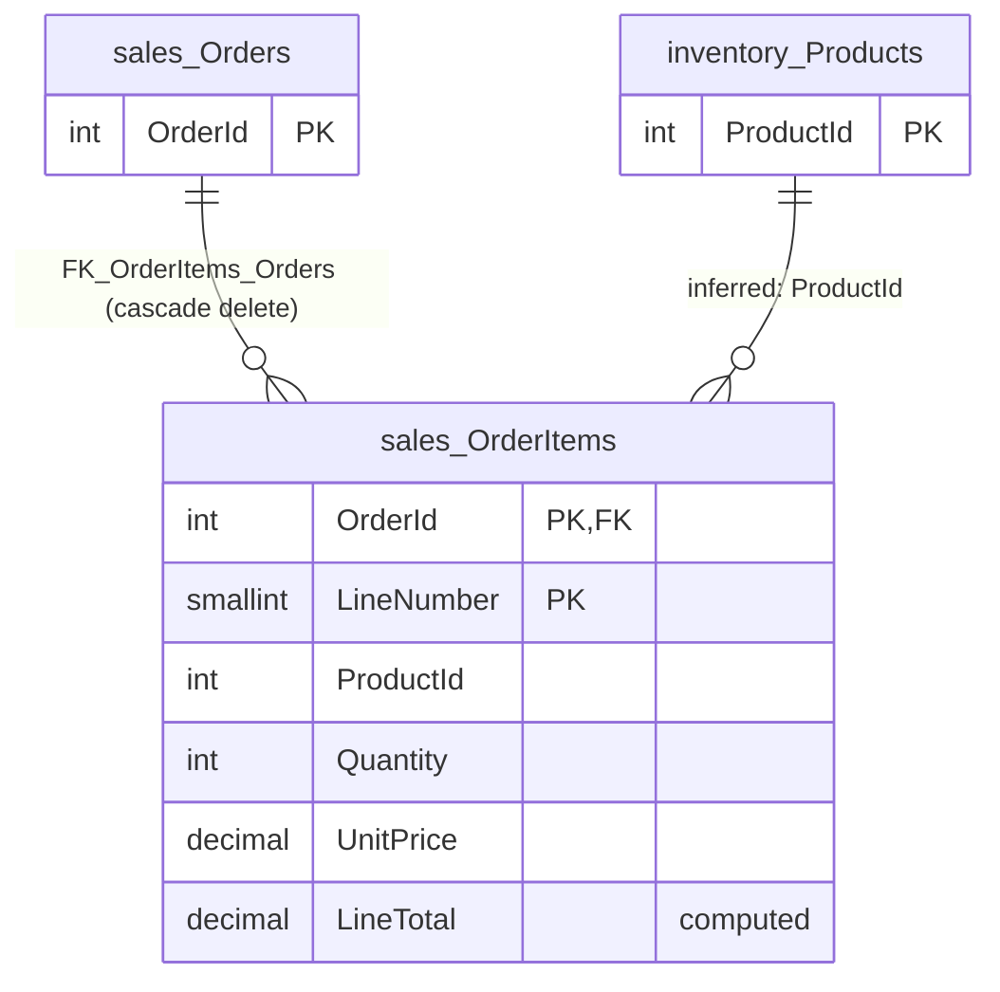

# sales.OrderItems

Business area: [Sales](../business-areas.md) · Source: [sales.OrderItems.json](../../extracted/sales.OrderItems.json) · [Database overview](../database-overview.md)

## Purpose

**Inferred:** the lines of customer orders. One row is one line of one order in [sales.Orders](orders.md): which
product was ordered, how many, at what unit price, and the resulting line total, which the database calculates. The
line is identified by the order number together with a line number within the order.

The export holds no stored description for the table, so this purpose is inferred from its columns, keys and
sample.

## Key facts

| Fact | Value |
|---|---|
| Schema | `sales` |
| Type | Table (user table) |
| Object id | 1525580473 |
| Created | 2026-10-18 16:19:10.723 |
| Last modified | 2026-10-18 16:19:10.730 |
| Row count | 10 (from the system catalog's partition statistics; treat as an estimate) |
| Primary key | `PK_OrderItems` on `OrderId`, `LineNumber` (composite, clustered) |
| Other identifiers | None |
| Temporal (system-versioned) | No |
| Partitioned | No |
| Stored description | None |
| Extended properties | None |
| Columns | 6 (one computed) |
| Columns flagged as sensitive by the export | 0 |
| Sample data | 10 of 10 rows (100 %), ordered by `OrderId`, `LineNumber`, limit 100 rows; nothing needed masking |
| Profile | Full-table statistics for every column |

## Field guide

| # | Column | Data type | Nullable | Keys | Default | Meaning |
|---|---|---|---|---|---|---|
| 1 | `OrderId` | int | No | PK (part 1), FK → `sales.Orders.OrderId` | | The order the line belongs to. |
| 2 | `LineNumber` | smallint | No | PK (part 2) | | Position of the line within its order, starting at 1 (**inferred** from the sample). |
| 3 | `ProductId` | int | No | Indexed | | The product ordered (**inferred** link to [inventory.Products](products.md); no foreign key). |
| 4 | `Quantity` | int | No | | | Number of units ordered; must be more than 0. |
| 5 | `UnitPrice` | decimal(10,2) | No | | | Price per unit at the time of the order, two decimals; currency not stated (**inferred**). |
| 6 | `LineTotal` | decimal(12,2) | Yes (computed) | | | Quantity × unit price, calculated by the database. |

**Confirmed structure:**

- Computed column: `LineTotal` = `(CONVERT([decimal](12,2),[Quantity]*[UnitPrice]))`. It is not persisted, so it is
  recalculated whenever it is read and cannot be entered directly. It is reported as nullable only because computed
  columns are; with both inputs required it always has a value.
- No identity column: `LineNumber` must be supplied when a line is added.
- No row-GUID, sparse or generated-always columns; no text columns, so no collation.
- No stored descriptions or classifications on any column.

**Sensitivity:** the export classifies no column as sensitive, and the sample was not masked.

## Relationships

| Direction | Related table | Columns | Cardinality | Evidence | Rules |
|---|---|---|---|---|---|
| Outgoing | [sales.Orders](orders.md) | `OrderId` → `Orders.OrderId` | Many lines to exactly one order (required) | **Confirmed** foreign key `FK_OrderItems_Orders`, enabled and trusted | On delete: **cascade**; on update: no action |
| Outgoing | [inventory.Products](products.md) | `ProductId` → `Products.ProductId` | Many lines to exactly one product | **Inferred**, no foreign key | Not enforced |

- **Order:** a line can only be stored for an existing order. Deleting the order deletes its lines automatically.
- **Product:** the column has the same name and type (`int`) as the products' primary key and has its own index. In
  the sample, the 10 lines use product numbers 1 to 7. Whether each exists in `inventory.Products` was not checked
  from this table's files. Confidence: high. Because the link is not enforced, a product can be deleted while order
  lines still refer to it.
- No table refers to this one.

## Constraints and defaults

| Name | Type | Column | Definition | In practice |
|---|---|---|---|---|
| `PK_OrderItems` | Primary key | `OrderId`, `LineNumber` | Clustered, unique | Each line number appears once per order. |
| `FK_OrderItems_Orders` | Foreign key (enabled, trusted) | `OrderId` | References `sales.Orders (OrderId)`; cascade on delete, no action on update | Lines belong to existing orders and disappear with their order. |
| `CK_OrderItems_Quantity` | Check (enabled, trusted) | `Quantity` | `([Quantity]>(0))` | Every line has at least one unit; zero or negative quantities (for example returns) are rejected. |

There are no default constraints and no unique constraints besides the primary key.

## Indexes, triggers and dependencies

**Indexes**

| Name | Type | Key columns | Included | Filter | Unique |
|---|---|---|---|---|---|
| `PK_OrderItems` | Clustered (primary key) | `OrderId` ASC, `LineNumber` ASC | none | none | Yes |
| `IX_OrderItems_ProductId` | Nonclustered | `ProductId` ASC | `Quantity` | none | No |

- `PK_OrderItems` stores an order's lines together, in line order.
- `IX_OrderItems_ProductId` serves "how many units of a product were ordered" without reading the whole row.

**Triggers:** none. Changes to order lines are not written to the audit log; only changes to the order itself are.

**Used by:**

- View `sales.vw_OrderSummary` reads this table (columns not listed by the export).
- Check constraint `CK_OrderItems_Quantity` uses `Quantity` (a constraint dependency, not a relationship).

The export notes that references made through dynamic SQL are not detected.

## Business rules

**Enforced by the database:**

- Every line belongs to an existing order and has a line number, product, quantity and unit price.
- Line numbers are unique within an order.
- Quantity is at least 1.
- The line total is always quantity × unit price, rounded to two decimals.
- Deleting an order deletes its lines.

**Inferred, needs validation:**

- `UnitPrice` is copied from the product's price when the order is taken, so later price changes do not alter past
  orders. The export does not show this process.
- Line numbers run 1, 2, … without gaps within an order (**observed sample**: orders have 1 or 2 lines, numbered
  from 1).
- The sum of an order's `LineTotal` values equals the order's `TotalAmount` in `sales.Orders` (true for all 7 orders
  in the sample).
- A negative or zero unit price is not prevented; no check constraint covers `UnitPrice`.

## Sample data and profile

**Sampling:** the export read all 10 rows (100 % coverage, limit 100), ordered by `OrderId` then `LineNumber`.
No column needed masking.

| `OrderId` | `LineNumber` | `ProductId` | `Quantity` | `UnitPrice` | `LineTotal` |
|---|---|---|---|---|---|
| 1000 | 1 | 1 | 1 | 14999.00 | 14999.00 |
| 1000 | 2 | 7 | 2 | 899.00 | 1798.00 |
| 1004 | 1 | 4 | 3 | 54999.00 | 164997.00 |

**Reported profile (full table, 10 rows):**

| Column | Empty | Distinct | Observations |
|---|---|---|---|
| `OrderId` | 0 | 7 | Orders 1000 to 1006; orders 1000, 1002 and 1006 have two lines, the others one. Every order in the sample has at least one line. |
| `LineNumber` | 0 | 2 | 1 (7 lines) and 2 (3 lines). |
| `ProductId` | 0 | 7 | Products 1 to 7; products 1, 5 and 6 appear on two lines each. |
| `Quantity` | 0 | 3 | 1 (6 lines), 2 (3 lines), 3 (1 line). |
| `UnitPrice` | 0 | 7 | 899.00 to 74,999.00. The same product has the same unit price on every line in the sample. |
| `LineTotal` | 0 | 9 | 1,299.00 to 164,997.00. |

## Common uses

**Inferred:**

- Show the content of an order, line by line, on screens, invoices and delivery notes.
- Sales by product: units and revenue per product (supported by `IX_OrderItems_ProductId`), joined to
  [inventory.Products](products.md) for names and categories.
- Check or recalculate the order total in [sales.Orders](orders.md).
- Order summaries through `sales.vw_OrderSummary`.

Counting pitfalls:

- Count orders with distinct `OrderId`, not with the number of lines.
- Exclude lines of Cancelled orders from revenue; the line has no status of its own, so join to `sales.Orders`.
- Do not add order totals after joining orders to their lines; use `LineTotal` for line-level sums.

## Diagram

How to read it: `||--o{` means "exactly one on the left, zero or more on the right": every line belongs to exactly
one order and refers to exactly one product, and an order or product can have no or many lines. The product line is
**inferred** (labelled "inferred"); the database does not enforce it.

## Assumptions and questions

**Assumptions**

- `ProductId` refers to `inventory.Products.ProductId`, although no foreign key says so.
- `UnitPrice` and `LineTotal` are in the same currency as the order total.

**Questions for the business**

1. Should a foreign key be added from `ProductId` to `inventory.Products`, so that products with order lines cannot
   be deleted?
2. Is `UnitPrice` the list price at the time of the order, or can it include discounts? Where are discounts and tax
   recorded?
3. Who assigns `LineNumber`, and must line numbers be consecutive?
4. Should changes to order lines also be written to the audit log, as changes to orders are?
5. Should zero or negative unit prices be blocked?
6. How are returns or credits recorded, given that quantities must be positive?
