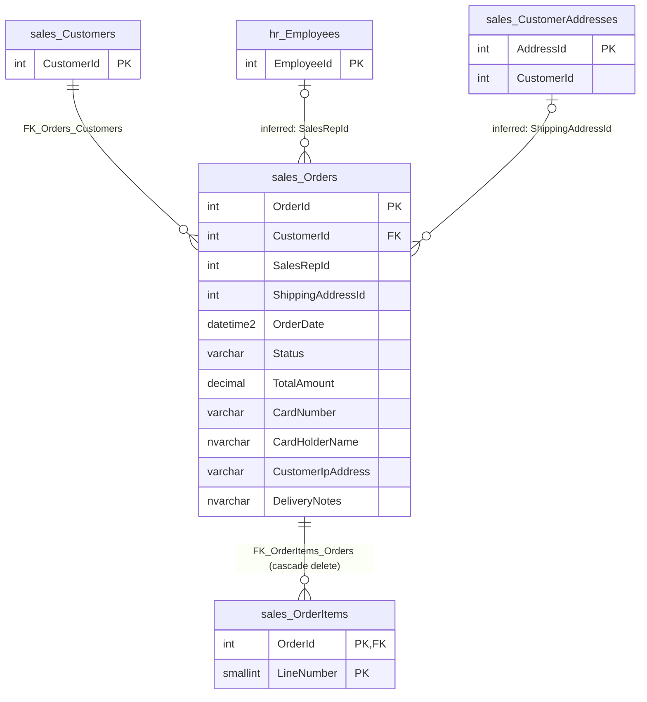

# sales.Orders

Business area: [Sales](../business-areas.md) · Source: [sales.Orders.json](../../extracted/sales.Orders.json) · [Database overview](../database-overview.md)

## Purpose

**Confirmed structure:** the table's stored description reads "Customer purchase orders."

One row is one order placed by one customer: when it was placed, its status (New, Paid, Shipped or Cancelled), its
total amount, how it was paid by card, the shipping address and the sales representative who handled it.
**Inferred:** the order lines (products, quantities, prices) are in [sales.OrderItems](orderitems.md); the order
total equals the sum of its lines in the sample.

## Key facts

| Fact | Value |
|---|---|
| Schema | `sales` |
| Type | Table (user table) |
| Object id | 1397580017 |
| Created | 2026-10-18 16:19:10.713 |
| Last modified | 2026-10-18 16:19:10.893 |
| Row count | 7 (from the system catalog's partition statistics; treat as an estimate) |
| Primary key | `PK_Orders` on `OrderId` (clustered) |
| Other identifiers | None |
| Temporal (system-versioned) | No |
| Partitioned | No |
| Stored description | "Customer purchase orders." |
| Extended properties | None besides descriptions |
| Columns | 11 |
| Columns flagged as sensitive by the export | 3 (`CardNumber`, `CardHolderName`, `CustomerIpAddress`) |
| Triggers | 1 (`trg_Orders_Audit`) |
| Sample data | 7 of 7 rows (100 %), most recent first by `OrderDate`, limit 100 rows; sensitive values masked |
| Profile | Full-table statistics for every column |

## Field guide

| # | Column | Data type | Nullable | Keys | Default | Meaning |
|---|---|---|---|---|---|---|
| 1 | `OrderId` | int | No | PK | Identity (1000, 1) | Order number, generated by the database starting at 1000. |
| 2 | `CustomerId` | int | No | FK → `sales.Customers.CustomerId` | | The customer who placed the order. |
| 3 | `SalesRepId` | int | Yes | | | Employee who handled the sale, not enforced by a foreign key (**stored description**); refers to [hr.Employees](employees.md) (**inferred**). |
| 4 | `ShippingAddressId` | int | Yes | | | The customer address the order ships to (**inferred** link to [sales.CustomerAddresses](customeraddresses.md); no foreign key). |
| 5 | `OrderDate` | datetime2(0) | No | | `sysutcdatetime()` | When the order was placed, to the whole second; UTC by default (**inferred**). |
| 6 | `Status` | varchar(12) | No | | `'New'` | Where the order is in its life cycle: New, Paid, Shipped or Cancelled. |
| 7 | `TotalAmount` | decimal(12,2) | No | | `0` | Total value of the order, two decimals, never negative. Currency is not stated (**unknown**). |
| 8 | `CardNumber` | varchar(19) | Yes | | | Payment card number used for the order (**inferred**). |
| 9 | `CardHolderName` | nvarchar(100) | Yes | | | Name on the payment card (**inferred**). |
| 10 | `CustomerIpAddress` | varchar(45) | Yes | | | Network (IP) address the customer ordered from; 45 characters fits both address formats (**inferred**). |
| 11 | `DeliveryNotes` | nvarchar(300) | Yes | | | Free-text delivery instructions (**inferred**). |

**Confirmed structure:**

- Identity: `OrderId` is an identity column starting at 1000 and increasing by 1.
- No computed, row-GUID, sparse or generated-always columns.
- Collation: the text columns use `SQL_Latin1_General_CP1_CI_AS` (case-insensitive, accent-sensitive).
- Stored descriptions: only `SalesRepId` has one ("Employee who handled the sale (not enforced by a foreign key).").
- No stored sensitivity classifications.

**Sensitivity (export heuristic, based on column names):** `CardNumber` and `CardHolderName` (financial) and
`CustomerIpAddress` (network identifier) were masked in the sample. `DeliveryNotes` is classified as not sensitive,
but the export's free-text scrubbing removed 3 pieces of sensitive content from it, and one note still mentions part
of a card number; treat `DeliveryNotes` as sensitive.

## Relationships

| Direction | Related table | Columns | Cardinality | Evidence | Rules |
|---|---|---|---|---|---|
| Outgoing | [sales.Customers](customers.md) | `CustomerId` → `Customers.CustomerId` | Many orders to exactly one customer (required) | **Confirmed** foreign key `FK_Orders_Customers`, enabled and trusted | On delete: no action; on update: no action |
| Outgoing | [hr.Employees](employees.md) | `SalesRepId` → `Employees.EmployeeId` | Many orders to zero or one employee | **Inferred** from the stored column description; no foreign key | Not enforced |
| Outgoing | [sales.CustomerAddresses](customeraddresses.md) | `ShippingAddressId` → `CustomerAddresses.AddressId` | Many orders to zero or one address | **Inferred**, no foreign key | Not enforced |
| Incoming | [sales.OrderItems](orderitems.md) | `OrderItems.OrderId` → `OrderId` | One order has zero or many lines; every line has exactly one order | **Confirmed** foreign key `FK_OrderItems_Orders`, enabled and trusted | On delete: **cascade**; on update: no action |

- **Customer:** every order must name an existing customer, and that customer cannot be deleted while it has orders.
- **Sales representative:** the stored description says the column holds the employee who handled the sale and that
  no foreign key enforces it. The sample uses employee numbers 102 and 103; whether they exist in `hr.Employees`
  was not checked from this table's files. Confidence: high for the meaning, unverified for the values.
- **Shipping address:** in the sample, all 7 orders point to an existing address, and each address belongs to the
  same customer as the order. Nothing enforces either.
- **Order lines:** deleting an order automatically deletes its lines (cascade).

## Constraints and defaults

| Name | Type | Column | Definition | In practice |
|---|---|---|---|---|
| `PK_Orders` | Primary key | `OrderId` | Clustered, unique | Each order number appears once. |
| `FK_Orders_Customers` | Foreign key (enabled, trusted) | `CustomerId` | References `sales.Customers (CustomerId)`; no action on delete or update | An order can only be stored for an existing customer. |
| `CK_Orders_Status` | Check (enabled, trusted) | `Status` | `([Status]='Cancelled' OR [Status]='Shipped' OR [Status]='Paid' OR [Status]='New')` | Only these four statuses are allowed. |
| `CK_Orders_TotalAmount` | Check (enabled, trusted) | `TotalAmount` | `([TotalAmount]>=(0))` | The total cannot be negative. |
| `DF_Orders_OrderDate` | Default | `OrderDate` | `(sysutcdatetime())` | Without a value, the current UTC date and time is stored. |
| `DF_Orders_Status` | Default | `Status` | `('New')` | A new order starts as New. |
| `DF_Orders_TotalAmount` | Default | `TotalAmount` | `((0))` | A new order starts with a total of 0. |

## Indexes, triggers and dependencies

**Indexes**

| Name | Type | Key columns | Included | Filter | Unique |
|---|---|---|---|---|---|
| `PK_Orders` | Clustered (primary key) | `OrderId` ASC | none | none | Yes |
| `IX_Orders_CustomerId_OrderDate` | Nonclustered | `CustomerId` ASC, `OrderDate` DESC | `Status`, `TotalAmount` | none | No |
| `IX_Orders_Open` | Nonclustered | `OrderDate` ASC | none | `([Status] IN ('New', 'Paid'))` | No |

- `IX_Orders_CustomerId_OrderDate` serves "a customer's orders, newest first, with status and total" without reading
  the whole row.
- `IX_Orders_Open` covers only orders with status New or Paid, which suggests these count as open orders still to be
  shipped (**inferred**).

**Triggers**

| Name | Events | Timing | Enabled | What it does |
|---|---|---|---|---|
| `trg_Orders_Audit` | INSERT, UPDATE, DELETE | AFTER, once per statement | Yes | Writes one row to [dbo.AuditLog](auditlog.md) per affected order with the table name `sales.Orders`, the order number and the action: I (insert), U (update) or D (delete). |

The trigger writes to the audit log but is not a relationship between the tables.

**Used by:**

- View `sales.vw_OrderSummary` and procedure `sales.usp_GetCustomerOrders` read this table (columns not listed by
  the export).
- Check constraints `CK_Orders_Status` and `CK_Orders_TotalAmount` use `Status` and `TotalAmount` (constraint
  dependencies, not relationships).

The export notes that references made through dynamic SQL are not detected.

## Business rules

**Enforced by the database:**

- Every order has a customer that exists, an order date, a status and a total.
- Status is New, Paid, Shipped or Cancelled; new orders start as New with a total of 0.
- The total is never negative.
- Deleting an order deletes its lines; a customer with orders cannot be deleted.
- Every insert, update and delete is recorded in `dbo.AuditLog`.

**Inferred, needs validation:**

- `TotalAmount` is the sum of the order's `LineTotal` values in `sales.OrderItems`: true for all 7 orders in the
  sample (**observed sample**), but nothing in the database calculates or checks it.
- Orders move from New to Paid to Shipped, or to Cancelled; the open-orders index treats New and Paid as open.
- Card details are optional: 2 of 7 orders have none (one New, one Cancelled), which suggests payment is recorded
  when the order is paid (**observed sample**, not consistent: another New order has card details).
- The shipping address belongs to the ordering customer (holds in the sample, not enforced).

## Sample data and profile

**Sampling:** the export read all 7 rows (100 % coverage, limit 100), most recent first by `OrderDate`, then by
`OrderId` descending. Orders date from 2026-09-01 10:15 to 2026-10-10 08:45. Sensitive columns were masked; values
marked `[hidden]` are masked or removed here.

| `OrderId` | `CustomerId` | `SalesRepId` | `ShippingAddressId` | `OrderDate` | `Status` | `TotalAmount` | `CardNumber` | `CardHolderName` | `CustomerIpAddress` | `DeliveryNotes` |
|---|---|---|---|---|---|---|---|---|---|---|
| 1005 | 5 | (empty) | 6 | 2026-10-03 18:05:00 | Paid | 1299.00 | [hidden] | [hidden] | [hidden] | (empty) |
| 1004 | 4 | 103 | 5 | 2026-10-01 11:10:00 | New | 164997.00 | [hidden] | [hidden] | (empty) | Deliver to the back office, gate 3. |
| 1002 | 2 | 103 | 3 | 2026-09-05 09:00:00 | Shipped | 6097.00 | [hidden] | [hidden] | [hidden] | Ring twice. |

**Reported profile (full table, 7 rows):**

| Column | Empty | Distinct | Observations |
|---|---|---|---|
| `OrderId` | 0 | 7 | 1000 to 1006, no gaps. |
| `CustomerId` | 0 | 6 | Customer 1 has two orders, customers 2 to 6 one each. |
| `SalesRepId` | 1 (14.29 %) | 2 | 102 (3 orders) and 103 (3 orders). |
| `ShippingAddressId` | 0 | 7 | Addresses 1 to 7; always filled although optional, each address used once. |
| `OrderDate` | 0 | 7 | 2026-09-01 10:15:00 to 2026-10-10 08:45:00. |
| `Status` | 0 | 4 | New 2, Paid 2, Shipped 2, Cancelled 1. |
| `TotalAmount` | 0 | 7 | 1,299.00 to 164,997.00. |
| `CardNumber` | 2 (28.57 %) | 4 | 5 filled values, only 4 different: one card number appears on orders of two different customers. |
| `CardHolderName` | 2 (28.57 %) | 4 | Filled on the same orders as `CardNumber`. In the sample the masked cardholder name always equals the masked name of the ordering customer. |
| `CustomerIpAddress` | 1 (14.29 %) | 5 | One address appears on both orders of customer 1. |
| `DeliveryNotes` | 2 (28.57 %) | 5 | Length 11 to 54 characters, average 40.4. The export redacted 3 pieces of sensitive content (a card number, an email address and a phone number); one note also mentions the last digits of a card. |

**Observed sample:** the one order with a card number shared with another customer has the cardholder name of its own
customer, so the same card appears under two different names.

## Common uses

**Inferred:**

- Order entry and order tracking: create orders, move them through Paid and Shipped, cancel them.
- List a customer's orders, newest first (supported by `IX_Orders_CustomerId_OrderDate` and
  `sales.usp_GetCustomerOrders`).
- Work queues of open orders (New and Paid) by date (supported by `IX_Orders_Open`).
- Sales reporting by period, region (through [sales.Customers](customers.md)) and sales representative (through
  [hr.Employees](employees.md)), for example via `sales.vw_OrderSummary`.
- Change history of orders through `dbo.AuditLog`.

Counting pitfalls:

- Exclude Cancelled orders from revenue: the cancelled order in the sample keeps its total.
- Do not add `TotalAmount` after joining to `sales.OrderItems`; the total repeats on every line. Sum `TotalAmount`
  per order or `LineTotal` per line, not both.
- `SalesRepId` can be empty; reports by representative must show unassigned orders separately.

## Diagram

How to read it: `||--o{` means "exactly one on the left, zero or more on the right": every order has exactly one
customer, and every order line exactly one order. `|o--o{` means "zero or one on the left": an order may name one
sales representative and one shipping address, or none. Lines labelled "inferred" are not enforced by the database.

## Assumptions and questions

**Assumptions**

- `SalesRepId` refers to `hr.Employees.EmployeeId`, as the stored description says, and `ShippingAddressId` refers
  to `sales.CustomerAddresses.AddressId`.
- `OrderDate` is in UTC when the default is used.
- Amounts are in one currency, which the export does not name.

**Questions for the business**

1. Why are full card numbers and cardholder names stored with orders? Card data normally must not be kept in plain
   form; can it be removed or replaced by a payment reference?
2. One card number appears on orders of two different customers under different cardholder names. Is this a data
   error, a shared card, or test data?
3. Delivery notes contain card, email and phone details. Should staff be told not to enter them, and should old notes
   be cleaned?
4. Should `TotalAmount` be calculated from the order lines automatically? Who keeps it in step today?
5. Which statuses count as revenue, and is New → Paid → Shipped the only allowed sequence? Can a Shipped order be
   cancelled?
6. Should foreign keys be added for `SalesRepId` and `ShippingAddressId`, and should the database check that the
   shipping address belongs to the ordering customer?
7. In which currency is `TotalAmount`?
8. Why is the customer's IP address stored, and how long is it kept?
