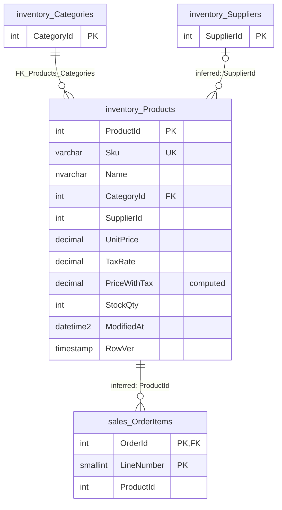

# inventory.Products

Business area: [Products and inventory](../business-areas.md) · Source: [inventory.Products.json](../../extracted/inventory.Products.json) · [Database overview](../database-overview.md)

## Purpose

**Confirmed (stored description):** "Products we sell."

**Inferred:** the product catalogue. One row is one sellable product with its stock-keeping code (SKU), name,
category, optional supplier, net unit price, tax rate, the price including tax that the database calculates, and the
quantity in stock. Order lines in [sales.OrderItems](orderitems.md) appear to refer to products by `ProductId`.

## Key facts

| Fact | Value |
|---|---|
| Schema | `inventory` |
| Type | Table (user table) |
| Object id | 1285579618 |
| Created | 2026-10-18 16:19:10.700 |
| Last modified | 2026-10-18 16:19:10.740 |
| Row count | 7 (from the system catalog's partition statistics; treat as an estimate; the full-table profile also counted 7) |
| Primary key | `PK_Products` on `ProductId` (clustered) |
| Other identifiers | `Sku` (unique constraint `UQ_Products_Sku`) |
| Temporal (system-versioned) | No |
| Partitioned | No |
| Stored description | "Products we sell." (table); one column description, on `PriceWithTax` |
| Extended properties | None besides the descriptions |
| Columns | 11 (one computed and persisted, one row version) |
| Columns flagged as sensitive by the export | 0 |
| Sample data | 7 of 7 rows (100 %), most recently changed first (by `ModifiedAt`, then `ProductId`, descending), limit 100 rows; sanitization on, nothing needed masking |
| Profile | Full-table statistics for every column (no distinct count for `RowVer`) |

## Field guide

| # | Column | Data type | Nullable | Keys | Default | Meaning |
|---|---|---|---|---|---|---|
| 1 | `ProductId` | int | No | PK, identity | | Number that identifies the product, assigned automatically by the database. |
| 2 | `Sku` | varchar(20) | No | Unique (`UQ_Products_Sku`) | | Stock-keeping unit: the business code of the product (**inferred** meaning). |
| 3 | `Name` | nvarchar(150) | No | Included in `IX_Products_CategoryId` | | Product name (**inferred**). Not required to be unique. |
| 4 | `CategoryId` | int | No | FK → `inventory.Categories.CategoryId`, indexed | | The category the product is classified in. |
| 5 | `SupplierId` | int | Yes | Indexed | | The supplier the product comes from, if known (**inferred** link to [inventory.Suppliers](suppliers.md); no foreign key). |
| 6 | `UnitPrice` | decimal(10,2) | No | Included in `IX_Products_CategoryId` | | Selling price per unit before tax, two decimals, zero or more; currency not stated (**inferred** meaning). |
| 7 | `TaxRate` | decimal(4,3) | No | | `0.180` | Tax rate as a fraction (0.180 = 18 %), up to 9.999 by its type (**inferred** meaning). |
| 8 | `PriceWithTax` | decimal(12,2) | Yes (computed) | | | Price including tax, calculated from `UnitPrice` and `TaxRate` (stored description). |
| 9 | `StockQty` | int | No | | `0` | Units in stock (**inferred** meaning). |
| 10 | `ModifiedAt` | datetime2(0) | Yes | | | Date and time (to the second, UTC) of the last update, set by trigger `trg_Products_ModifiedAt`; empty until the product is first changed. |
| 11 | `RowVer` | timestamp (row version) | No | | | Version number the database changes on every insert and update (**inferred** use: detecting conflicting edits). |

**Confirmed structure:**

- Identity: `ProductId` starts at 1 and increases by 1 for each new product.
- Computed column: `PriceWithTax` = `(CONVERT([decimal](12,2),[UnitPrice]*((1)+[TaxRate])))`, **persisted** (stored
  and kept up to date by the database). It cannot be entered directly. It is reported as nullable only because
  computed columns are; with both inputs required it always has a value.
- Row version: `RowVer` (type `timestamp`, also called rowversion) is filled and changed by the database itself; it
  is not a date or time.
- Collation: `Sku` and `Name` use `SQL_Latin1_General_CP1_CI_AS` (case is ignored when comparing), so SKUs that
  differ only in case count as the same SKU.
- No row-GUID, sparse or generated-always columns.
- Stored description on `PriceWithTax`: "Price including tax, calculated from UnitPrice and TaxRate."

**Sensitivity:** the export classifies no column as sensitive, and the sample was not masked. That classification
alone does not prove a value is safe to publish; prices and stock levels may be commercially confidential.

## Relationships

| Direction | Related table | Columns | Cardinality | Evidence | Rules |
|---|---|---|---|---|---|
| Outgoing | [inventory.Categories](categories.md) | `CategoryId` → `Categories.CategoryId` | Many products to exactly one category (required) | **Confirmed** foreign key `FK_Products_Categories`, enabled and trusted | On delete: no action; on update: no action |
| Outgoing | [inventory.Suppliers](suppliers.md) | `SupplierId` → `Suppliers.SupplierId` | Many products to zero or one supplier (optional) | **Inferred**, no foreign key | Not enforced |
| Incoming | [sales.OrderItems](orderitems.md) | `OrderItems.ProductId` → `ProductId` | One product to zero or more order lines | **Inferred**, no foreign key | Not enforced |

- **Category:** a product can only be saved with an existing category, and a category with products cannot be
  deleted.
- **Supplier:** evidence: same name and type (`int`) as the suppliers' primary key, an index on the column
  (`IX_Products_SupplierId`), and in the sample the filled values 1 to 3 match the three supplier numbers. The column
  is optional (one product has no supplier). Confidence: high. Because no foreign key exists, a supplier can be
  deleted while products still refer to it, and a non-existent supplier number is accepted.
- **Order lines:** the export records no foreign key to this table (`referencedBy` is empty). The link from
  `sales.OrderItems.ProductId` rests on the same column name and type as this table's primary key; see
  [sales.OrderItems](orderitems.md). Confidence: high. A product can be deleted while order lines still refer to it.

## Constraints and defaults

| Name | Type | Column | Definition | In practice |
|---|---|---|---|---|
| `PK_Products` | Primary key | `ProductId` | Clustered, unique | Each product has its own number. |
| `UQ_Products_Sku` | Unique | `Sku` | Nonclustered unique index | No two products share a SKU (ignoring case). |
| `FK_Products_Categories` | Foreign key (enabled, trusted) | `CategoryId` | References `inventory.Categories (CategoryId)`; no action on delete and update | Every product is in an existing category. |
| `CK_Products_UnitPrice` | Check (enabled, trusted) | `UnitPrice` | `([UnitPrice]>=(0))` | Prices cannot be negative; a price of 0 (for example a free item) is allowed. |
| `DF_Products_TaxRate` | Default | `TaxRate` | `((0.180))` | New products get an 18 % tax rate unless another rate is given. |
| `DF_Products_StockQty` | Default | `StockQty` | `((0))` | New products start with no stock unless a quantity is given. |

There is no check on `TaxRate` or `StockQty`: negative tax rates or negative stock are not prevented.

## Indexes, triggers and dependencies

**Indexes**

| Name | Type | Key columns | Included | Filter | Unique |
|---|---|---|---|---|---|
| `PK_Products` | Clustered (primary key) | `ProductId` ASC | none | none | Yes |
| `UQ_Products_Sku` | Nonclustered (unique constraint) | `Sku` ASC | none | none | Yes |
| `IX_Products_CategoryId` | Nonclustered | `CategoryId` ASC | `Name`, `UnitPrice` | none | No |
| `IX_Products_SupplierId` | Nonclustered | `SupplierId` ASC | none | none | No |

- `UQ_Products_Sku` enforces unique SKUs and serves look-ups by SKU.
- `IX_Products_CategoryId` serves "list the products of a category with name and price" without reading the full
  row.
- `IX_Products_SupplierId` serves "which products come from this supplier".

**Triggers**

| Name | Event | Timing | Enabled | What it does |
|---|---|---|---|---|
| `trg_Products_ModifiedAt` | UPDATE | AFTER (once per statement) | Yes | Sets `ModifiedAt` to the current UTC date and time on every product changed by the update. If the update itself set `ModifiedAt`, the trigger does nothing, which also stops it from firing itself again. |

- Inserts do not fill `ModifiedAt`, so a new product has an empty `ModifiedAt` until its first update.
- Because an update that sets `ModifiedAt` is left alone, a caller can write any time into `ModifiedAt`.
- The trigger does not write to the audit log.

**Used by:** check constraint `CK_Products_UnitPrice` (uses `UnitPrice`) and trigger `trg_Products_ModifiedAt`. These
are dependencies within the table, not relationships with other tables. The export lists no view, procedure or
function that uses this table, and notes that references made through dynamic SQL are not detected.

## Business rules

**Enforced by the database:**

- Every product has a SKU (unique, ignoring case), a name, an existing category, a unit price of zero or more, a tax
  rate and a stock quantity.
- New products get a tax rate of 0.180 and a stock quantity of 0 unless other values are given.
- The price including tax is always `UnitPrice × (1 + TaxRate)`, rounded to two decimals, and is stored.
- Every update stamps `ModifiedAt` with the UTC time of the change, unless the update sets it itself.
- `RowVer` changes on every insert and update.

**Inferred, needs validation:**

- The supplier is optional and refers to [inventory.Suppliers](suppliers.md); the database does not check that the
  supplier exists.
- The SKU starts with a two-letter prefix that matches the product's category, followed by a hyphen and four digits
  (**observed sample**: all 7 SKUs are 7 characters in this form). Nothing enforces this.
- Prices are net of tax and the same tax rate applies to all products (**observed sample**: every product has 0.180).
- Stock is not reduced by the database when orders are placed; this table's files show no such process, and stock can
  go below zero.

## Sample data and profile

**Sampling:** the export read all 7 rows (100 % coverage, limit 100), most recently changed first (`ModifiedAt`
descending, then `ProductId` descending). The only filled `ModifiedAt` is 2026-10-18 10:49:11. Sanitization was on;
no column needed masking. `RowVer` values are shown as the export gave them and only mean "newer or older".

| `ProductId` | `Sku` | `Name` | `CategoryId` | `SupplierId` | `UnitPrice` | `TaxRate` | `PriceWithTax` | `StockQty` | `ModifiedAt` | `RowVer` |
|---|---|---|---|---|---|---|---|---|---|---|
| 1 | PH-1001 | Smartphone A1 | 2 | 1 | 14999.00 | 0.180 | 17698.82 | 39 | 2026-10-18 10:49:11 | 2010 |
| 7 | HM-4001 | LED Desk Lamp | 4 | *(empty)* | 899.00 | 0.180 | 1060.82 | 100 | *(empty)* | 2007 |
| 3 | LT-2001 | Laptop Pro 14 | 3 | 2 | 74999.00 | 0.180 | 88498.82 | 10 | *(empty)* | 2003 |

**Reported profile (full table, 7 rows):**

| Column | Empty | Distinct | Observations |
|---|---|---|---|
| `ProductId` | 0 | 7 | 1 to 7, no gaps. |
| `Sku` | 0 | 7 | All exactly 7 characters. |
| `Name` | 0 | 7 | 13 to 15 characters, average 13.3; unique in the data, though not required. |
| `CategoryId` | 0 | 4 | Categories 2, 3 and 5 have two products each, category 4 one; category 1 has none directly. |
| `SupplierId` | 1 (14 %) | 3 | Suppliers 1, 2 and 3 have two products each; one product has no supplier. |
| `UnitPrice` | 0 | 7 | 899.00 to 74,999.00. |
| `TaxRate` | 0 | 1 | Always 0.180. |
| `PriceWithTax` | 0 | 7 | 1,060.82 to 88,498.82. |
| `StockQty` | 0 | 7 | 10 to 100. |
| `ModifiedAt` | 6 (86 %) | 1 | Only product 1 has been updated since it was added. |
| `RowVer` | 0 | 7 in sample | No full-table distinct count; product 1 has the highest value, matching its later update. |

**Observed sample:** in categories, products sit in sub-categories (Phones, Laptops, Kitchen) and in one top-level
category (Home); the top-level category Electronics holds no product directly.

## Common uses

**Inferred:**

- Maintain the product catalogue: names, SKUs, categories, prices and tax rates.
- Show product lists by category with prices (supported by `IX_Products_CategoryId`).
- Check stock levels and plan re-orders per supplier (supported by `IX_Products_SupplierId`).
- Report sales by product and category, by joining from [sales.OrderItems](orderitems.md).
- Detect concurrent edits with `RowVer`, and recent changes with `ModifiedAt`.

Counting pitfalls:

- `UnitPrice` is the current price; past orders carry their own unit price in the order lines, so do not value past
  sales with this table's price.
- `StockQty` is a single current figure per product; there is no stock history or per-location stock in this table.
- Products without a supplier drop out of an inner join to suppliers; use an outer join when counting all products.
- Category totals must include sub-categories (see [inventory.Categories](categories.md)).

## Diagram

How to read it: `||--o{` means "exactly one on the left, zero or more on the right": every product has exactly one
category, and every order line refers to exactly one product. `|o--o{` means "zero or one on the left, zero or more
on the right": a product has at most one supplier, and a supplier can have no or many products. The supplier and
order-line links are **inferred** (labelled "inferred"); the database does not enforce them.

## Assumptions and questions

**Assumptions**

- `SupplierId` refers to `inventory.Suppliers.SupplierId`, and `sales.OrderItems.ProductId` refers to `ProductId`,
  although no foreign key says so.
- `UnitPrice` is a net price and `TaxRate` a fraction; prices are in one currency, which the export does not name.
- `ModifiedAt` is in UTC, as the trigger code uses the current UTC time.

**Questions for the business**

1. Should foreign keys be added from `SupplierId` to suppliers and from order lines to products, so that suppliers
   and products in use cannot be deleted?
2. Which currency are prices in, and is the default tax rate of 18 % correct for all products?
3. Should negative stock and negative or unrealistic tax rates be blocked?
4. Which process updates `StockQty` (goods receipt, orders, stock counts)? Should stock be reduced when an order is
   placed?
5. Must the SKU follow the category-prefix pattern seen in the sample?
6. Should changes to products (especially prices) be written to the audit log, as changes to orders and employees are?
