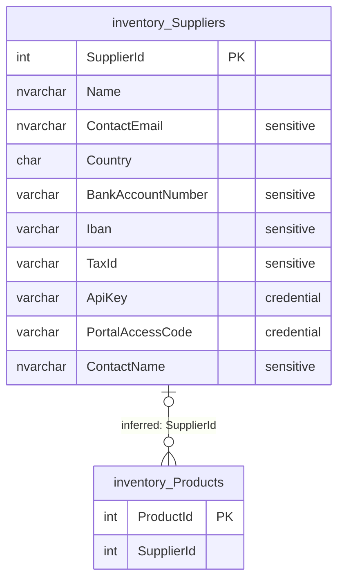

# inventory.Suppliers

Business area: [Products and inventory](../business-areas.md) · Source: [inventory.Suppliers.json](../../extracted/inventory.Suppliers.json) · [Database overview](../database-overview.md)

## Purpose

**Inferred:** the companies the business buys products from. One row is one supplier company with its name, contact
person and email, country, payment details (domestic bank account or IBAN), tax registration number and two access
credentials (an API key and a supplier-portal access code). Products in [inventory.Products](products.md) appear to
name their supplier by `SupplierId`.

The export holds no stored description for the table, so this purpose is inferred from its columns and sample.

## Key facts

| Fact | Value |
|---|---|
| Schema | `inventory` |
| Type | Table (user table) |
| Object id | 1237579447 |
| Created | 2026-10-18 16:19:10.697 |
| Last modified | 2026-10-18 16:19:10.897 |
| Row count | 3 (from the system catalog's partition statistics; treat as an estimate; the full-table profile also counted 3) |
| Primary key | `PK_Suppliers` on `SupplierId` (clustered) |
| Other identifiers | None (supplier names are not required to be unique) |
| Temporal (system-versioned) | No |
| Partitioned | No |
| Stored description | None |
| Extended properties | None |
| Columns | 10 |
| Columns flagged as sensitive by the export | 7 of 10 |
| Sample data | 3 of 3 rows (100 %), most recently inserted first (by `SupplierId` descending), limit 100 rows; sanitization on: 5 columns masked, 2 credential columns not read at all |
| Profile | Full-table statistics for every column except the two credential columns |

## Field guide

| # | Column | Data type | Nullable | Keys | Default | Meaning |
|---|---|---|---|---|---|---|
| 1 | `SupplierId` | int | No | PK, identity | | Number that identifies the supplier, assigned automatically by the database. |
| 2 | `Name` | nvarchar(150) | No | | | Company name of the supplier (**inferred**). Not required to be unique. |
| 3 | `ContactEmail` | nvarchar(256) | Yes | | | Email address for contacting the supplier (**inferred**). Sensitive. |
| 4 | `Country` | char(2) | No | | `'IN'` | Two-letter country code, apparently ISO style (**inferred**); IN unless another is given. |
| 5 | `BankAccountNumber` | varchar(20) | Yes | | | Domestic bank account number for paying the supplier (**inferred**). Sensitive. |
| 6 | `Iban` | varchar(34) | Yes | | | International bank account number (IBAN, at most 34 characters) for paying the supplier (**inferred**). Sensitive. |
| 7 | `TaxId` | varchar(20) | Yes | | | Tax registration number of the supplier (**inferred**). Sensitive. |
| 8 | `ApiKey` | varchar(64) | Yes | | | Secret key for system-to-system access (**inferred**). Credential. |
| 9 | `PortalAccessCode` | varchar(20) | Yes | | | Access code for a supplier portal (**inferred**). Credential, classified in the database. |
| 10 | `ContactName` | nvarchar(100) | Yes | | | Name of the contact person at the supplier (**inferred**). Sensitive. |

**Confirmed structure:**

- Identity: `SupplierId` starts at 1 and increases by 1 for each new supplier.
- Collation: all text columns use `SQL_Latin1_General_CP1_CI_AS` (case is ignored when comparing).
- No computed, row-GUID, sparse or generated-always columns.
- No stored descriptions on any column.

**Sensitivity:**

| Column | Category | Source | Sample handling |
|---|---|---|---|
| `ContactEmail` | ContactEmail | Export's name heuristic | Masked |
| `BankAccountNumber` | Financial | Export's name heuristic | Masked |
| `Iban` | Financial | Export's name heuristic | Masked |
| `TaxId` | GovernmentId | Export's name heuristic | Masked |
| `ApiKey` | Credential | Export's name heuristic | Not read |
| `PortalAccessCode` | Credential | **Database data classification**: label "Highly Confidential", information type "Credentials", rank HIGH | Not read |
| `ContactName` | PersonName | Export's name heuristic | Masked |

Only `PortalAccessCode` carries a classification stored in the database; the others are the export's guesses from
column names. `SupplierId`, `Name` and `Country` are classified None, which does not prove they are safe to publish.
Storing an API key and an access code in plain columns is a security concern (**inferred**): the export cannot tell
whether they are encrypted or hashed.

## Relationships

| Direction | Related table | Columns | Cardinality | Evidence | Rules |
|---|---|---|---|---|---|
| Incoming | [inventory.Products](products.md) | `Products.SupplierId` → `SupplierId` | One supplier to zero or more products; a product has zero or one supplier (optional) | **Inferred**, no foreign key | Not enforced |

- No foreign key points to or from this table (`foreignKeys` and `referencedBy` are empty in the export).
- Evidence for the link: `inventory.Products.SupplierId` has the same name and type (`int`) as this table's primary
  key and has its own index, and the product sample uses supplier numbers 1 to 3, which match the three suppliers.
  Confidence: high.
- Because the link is not enforced, a supplier can be deleted while products still name it.

## Constraints and defaults

| Name | Type | Column | Definition | In practice |
|---|---|---|---|---|
| `PK_Suppliers` | Primary key | `SupplierId` | Clustered, unique | Each supplier has its own number. |
| `DF_Suppliers_Country` | Default | `Country` | `('IN')` | A new supplier gets country IN unless another is given. |

There are no check, unique or foreign key constraints. Nothing checks the format of email addresses, country codes,
bank account numbers, IBANs or tax numbers.

## Indexes, triggers and dependencies

**Indexes**

| Name | Type | Key columns | Included | Filter | Unique |
|---|---|---|---|---|---|
| `PK_Suppliers` | Clustered (primary key) | `SupplierId` ASC | none | none | Yes |

The only index is the primary key; searching by name or country reads the whole table (unimportant at 3 rows).

**Triggers:** none. Changes to suppliers, including their bank details, are not written to the audit log.

**Used by:** the export lists no views, procedures or functions that use this table, and notes that references made
through dynamic SQL are not detected.

## Business rules

**Enforced by the database:**

- Every supplier has a name and a two-letter country code; the country is IN when none is given.
- All contact, payment, tax and credential details are optional.

**Inferred, needs validation:**

- A supplier is paid either to a domestic bank account or to an IBAN (**observed sample**: the two suppliers in IN
  have a bank account number and no IBAN; the supplier in SG has an IBAN and no bank account number). The database
  requires neither and does not prevent both.
- Every supplier has a tax number (**observed sample**: `TaxId` is filled for all 3), although the column is optional.
- Supplier names are unique in practice (all 3 differ), but nothing enforces it.
- Banking, tax, contact and credential details must only be visible to authorised staff.

## Sample data and profile

**Sampling:** the export read all 3 rows (100 % coverage, limit 100), most recently inserted first (`SupplierId`
descending). Sanitization was on: `ContactEmail`, `BankAccountNumber`, `Iban`, `TaxId` and `ContactName` were
replaced by masks, shown here as `[hidden]`; `ApiKey` and `PortalAccessCode` were not read, so the sample does not
contain them.

| `SupplierId` | `Name` | `ContactEmail` | `Country` | `BankAccountNumber` | `Iban` | `TaxId` | `ApiKey` | `PortalAccessCode` | `ContactName` |
|---|---|---|---|---|---|---|---|---|---|
| 3 | HomeWorks Wholesale | *(empty)* | IN | [hidden] | *(empty)* | [hidden] | *(not read)* | *(not read)* | *(empty)* |
| 2 | Global Gadgets Ltd | [hidden] | SG | *(empty)* | [hidden] | [hidden] | *(not read)* | *(not read)* | [hidden] |
| 1 | Bharat Electronics Supply | [hidden] | IN | [hidden] | *(empty)* | [hidden] | *(not read)* | *(not read)* | [hidden] |

**Reported profile (full table, 3 rows):**

| Column | Empty | Distinct | Observations |
|---|---|---|---|
| `SupplierId` | 0 | 3 | 1 to 3, no gaps. |
| `Name` | 0 | 3 | 18 to 25 characters. |
| `ContactEmail` | 1 (33 %) | 2 | Filled values all differ. |
| `Country` | 0 | 2 | IN (2), SG (1). |
| `BankAccountNumber` | 1 (33 %) | 2 | Filled values all differ. |
| `Iban` | 2 (67 %) | 1 | One supplier has an IBAN. |
| `TaxId` | 0 | 3 | Filled for every supplier, all different. |
| `ApiKey` | Unknown | Unknown | Not profiled: credential column, not read. |
| `PortalAccessCode` | Unknown | Unknown | Not profiled: credential column, not read. |
| `ContactName` | 1 (33 %) | 2 | Filled values all differ. |

Lengths are not reported for the masked columns.

## Common uses

**Inferred:**

- Keep the list of suppliers with their contact details.
- Pay suppliers (bank account or IBAN) and record their tax registration for invoices and tax reporting.
- Give suppliers access to a portal or an API (`PortalAccessCode`, `ApiKey`).
- List the products of each supplier and plan re-orders, by joining to [inventory.Products](products.md).

Counting pitfalls:

- Products without a supplier do not appear in a supplier-to-product inner join.
- A supplier with no products still exists here; count suppliers from this table, not from products.

## Diagram

How to read it: `|o--o{` means "zero or one on the left, zero or more on the right": a product has at most one
supplier, and a supplier can have no or many products. The link is **inferred** (labelled "inferred"); the database
does not enforce it.

## Assumptions and questions

**Assumptions**

- `Country` holds two-letter ISO country codes.
- `BankAccountNumber` is used for domestic payments and `Iban` for international ones.
- `ApiKey` and `PortalAccessCode` are credentials issued to the supplier.

**Questions for the business**

1. Should a foreign key be added from `inventory.Products.SupplierId` to this table, so that suppliers with products
   cannot be deleted?
2. Are `ApiKey` and `PortalAccessCode` stored in plain text? Should they be hashed, encrypted or moved to a secrets
   store?
3. Must every supplier have either a bank account number or an IBAN, and must every supplier have a tax number?
4. Should supplier names be unique?
5. Should changes to supplier bank details be written to the audit log, given the risk of payment fraud?
6. Should the export's name-based classifications of the other sensitive columns be stored as database
   classifications, like the one on `PortalAccessCode`?
