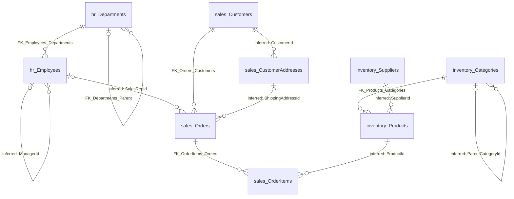

# SEH_Validation_Retail relationships

The database has 5 confirmed relationships (foreign keys enforced by the database) and 7 inferred relationships
(links without a foreign key that the structure and samples support). See [database-overview.md](database-overview.md)
for the wider picture.

## How to read this document

- **Parent and child:** in each relationship the child table holds a column (the "from" columns) that stores the
  key of a row in the parent table (the "to" columns).
- **Cardinality:** "many-to-one" means many child rows can point to the same parent row, and each child row points
  to at most one parent.
- **Optionality:** "required" means the child column cannot be empty, so every child row has a parent. "Optional"
  means the column can be empty, so a child row can exist without a parent.
- **Confirmed:** a foreign key exists. The database rejects child values that match no parent row. "Enabled" means
  the rule is active; "trusted" means the database has checked all existing rows against it.
- **Inferred:** no foreign key exists. The link is our interpretation of names, data types, indexes, stored
  descriptions and sample values. The database does not stop child values that match no parent.
- **Delete and update rules:** what happens to child rows when the parent row is deleted or its key changes.
  "No action" blocks the change while child rows exist; "cascade" deletes the child rows too.

## Confirmed relationships

All five foreign keys are enabled and trusted, and each has a single column that points to the parent's
primary key.

| Name | From (child) | To (parent) | Cardinality | Optionality | State | On delete | On update | Self-reference |
|---|---|---|---|---|---|---|---|---|
| `FK_Departments_Parent` | [hr.Departments](documentation/departments.md) `ParentDepartmentId` | [hr.Departments](documentation/departments.md) `DepartmentId` | many-to-one | Optional (column can be empty) | Enabled, trusted | No action | No action | Yes |
| `FK_Employees_Departments` | [hr.Employees](documentation/employees.md) `DepartmentId` | [hr.Departments](documentation/departments.md) `DepartmentId` | many-to-one | Required | Enabled, trusted | No action | No action | No |
| `FK_Products_Categories` | [inventory.Products](documentation/products.md) `CategoryId` | [inventory.Categories](documentation/categories.md) `CategoryId` | many-to-one | Required | Enabled, trusted | No action | No action | No |
| `FK_OrderItems_Orders` | [sales.OrderItems](documentation/orderitems.md) `OrderId` | [sales.Orders](documentation/orders.md) `OrderId` | many-to-one | Required | Enabled, trusted | Cascade | No action | No |
| `FK_Orders_Customers` | [sales.Orders](documentation/orders.md) `CustomerId` | [sales.Customers](documentation/customers.md) `CustomerId` | many-to-one | Required | Enabled, trusted | No action | No action | No |

In plain words:

- A department can sit under one parent department; top-level departments have none.
- Every employee belongs to exactly one department.
- Every product belongs to exactly one category.
- Every order line belongs to exactly one order, and `OrderId` is also the first part of the order line's
  primary key. Deleting an order deletes its lines.
- Every order is placed by exactly one customer.

## Inferred relationships

None of these has a foreign key. In every case the child column has the same data type (`int`) as the parent's
primary key, and the parent column is unique. The sample rows cover every row of each table at export time (the
samples returned as many rows as the row counts).

| From (child) | To (parent) | Cardinality | Optionality | Confidence |
|---|---|---|---|---|
| [sales.Orders](documentation/orders.md) `SalesRepId` | [hr.Employees](documentation/employees.md) `EmployeeId` | many-to-one | Optional | High |
| [hr.Employees](documentation/employees.md) `ManagerId` | [hr.Employees](documentation/employees.md) `EmployeeId` | many-to-one (self-reference) | Optional | High |
| [sales.OrderItems](documentation/orderitems.md) `ProductId` | [inventory.Products](documentation/products.md) `ProductId` | many-to-one | Required | High |
| [sales.CustomerAddresses](documentation/customeraddresses.md) `CustomerId` | [sales.Customers](documentation/customers.md) `CustomerId` | many-to-one | Required | High |
| [inventory.Products](documentation/products.md) `SupplierId` | [inventory.Suppliers](documentation/suppliers.md) `SupplierId` | many-to-one | Optional | High |
| [sales.Orders](documentation/orders.md) `ShippingAddressId` | [sales.CustomerAddresses](documentation/customeraddresses.md) `AddressId` | many-to-one | Optional | Medium to high |
| [inventory.Categories](documentation/categories.md) `ParentCategoryId` | [inventory.Categories](documentation/categories.md) `CategoryId` | many-to-one (self-reference) | Optional | Medium to high |

Evidence for each:

- **Order to sales representative** (`SalesRepId`): the stored column description says "Employee who handled the
  sale (not enforced by a foreign key)", and the stored description of `hr.Employees` mentions sales
  representatives. The view `sales.vw_OrderSummary` reads both `sales.Orders` and `hr.Employees`. Observed sample:
  every filled value matches an employee; one order has no sales representative. Uncertain: whether every
  employee may be named, or only active employees in a sales role.
- **Employee to manager** (`ManagerId`): the stored column description says "Line manager of the employee (not
  enforced by a foreign key)". Observed sample: every filled value matches an employee, and one employee has no
  manager (the top of the hierarchy). Uncertain: nothing prevents an employee from being their own manager or
  from forming a loop.
- **Order line to product** (`ProductId`): same name as the product key, required, and indexed
  (`IX_OrderItems_ProductId`). Observed sample: every value matches a product. Uncertain: whether a product that
  has been ordered may be deleted. Nothing in the database prevents it.
- **Address to customer** (`CustomerId`): same name as the customer key, required, and indexed twice
  (`IX_CustomerAddresses_CustomerId`, and the filtered unique index `UX_CustomerAddresses_Default` that allows one
  default address per customer). Observed sample: every value matches a customer, and one customer has two
  addresses.
- **Product to supplier** (`SupplierId`): same name as the supplier key, optional, and indexed
  (`IX_Products_SupplierId`). Observed sample: every filled value matches a supplier, and one product has no
  supplier.
- **Order to shipping address** (`ShippingAddressId`): the name differs from the parent key (`AddressId`), so the
  link rests on the name "address", the matching type, business sense and the samples. Observed sample: every
  value matches an address, and each order's address belongs to the customer who placed the order. Uncertain: the
  database does not require the address to belong to the ordering customer, and the column is not indexed.
- **Category to parent category** (`ParentCategoryId`): it follows the same pattern as `hr.Departments`, where the
  equivalent link is an enforced foreign key. Observed sample: every filled value matches a category; two
  categories have no parent. Uncertain: there is no stored description and no index.

## Rejected or unsupported candidates

- **`dbo.AuditLog` (`TableName`, `RecordId`) to any table.** The triggers on `sales.Orders` and `hr.Employees` write
  the table name and the changed row's key into the audit log, so `RecordId` holds an order number when
  `TableName` is `sales.Orders` and an employee number when it is `hr.Employees`. This is a "polymorphic" reference
  (one column pointing to different tables) and cannot be a single relationship. Joining `RecordId` to
  `sales.Orders.OrderId` or `hr.Employees.EmployeeId` without also filtering on `TableName` gives wrong matches.
  Deleted rows also keep their audit entries, so some audit rows may have no matching row.
- **`dbo.AuditLog.ChangedBy` to `hr.Employees.UserName`.** `ChangedBy` defaults to the database login that made the
  change, not to an application user name, so it is not a reliable link to employees.
- **`sales.OrderItems.UnitPrice` to `inventory.Products.UnitPrice`.** Same name and type, but the order line keeps
  the price at the time of sale. It is a copied value, not a key, and prices can differ.
- **`hr.Employees.DeviceId`.** It ends in "Id" but is text (`varchar(64)`) and no table of devices exists in the
  export.
- **`inventory.Suppliers.TaxId`.** A tax registration number, not a link to another table.
- **`sales.Customers.Region`.** A fixed list of regions (North, South, East, West) checked by a constraint; no
  region table exists.

## Examples of connected records

Observed sample, showing key numbers only:

| Child row | Points to | Parent row exists |
|---|---|---|
| `hr.Employees` with `EmployeeId` 101, `ManagerId` 100 | `hr.Employees` with `EmployeeId` 100, which has no manager | Yes |
| `inventory.Products` with `ProductId` 4, `CategoryId` 3, `SupplierId` 1 | `inventory.Categories` 3 (parent category 1) and `inventory.Suppliers` 1 | Yes |
| `sales.CustomerAddresses` with `AddressId` 2, `CustomerId` 1 | `sales.Customers` 1, which also owns `AddressId` 1 | Yes |

## Using these relationships in joins and reports

- **Order lines multiply order rows.** Joining `sales.Orders` to `sales.OrderItems` returns one row per line.
  Summing `TotalAmount` after that join counts each order once per line. Sum order totals before joining, or sum
  `LineTotal` instead.
- **Use outer joins for optional links.** An inner join to `hr.Employees` on `SalesRepId`, to
  `sales.CustomerAddresses` on `ShippingAddressId`, or to `inventory.Suppliers` on `SupplierId` silently drops
  orders or products where the column is empty.
- **Unenforced links can break.** For the 7 inferred links the database accepts values with no matching parent.
  Use outer joins and check for missing parents before relying on inner joins.
- **Customers and addresses.** A customer can have several addresses. Joining customers to all addresses
  duplicates customer rows. Filter on `IsDefault` = 1 to get one default address (at most one per customer), or
  use the order's `ShippingAddressId` for the delivery address.
- **Self-references.** Departments, employees and categories point to rows in their own table. Reporting a full
  hierarchy (all sub-departments, all reports of a manager) needs a recursive query. The employee and category
  hierarchies are not protected against loops.
- **Order lines and products.** `sales.OrderItems.UnitPrice` is the price on the order. Use it for revenue rather
  than the product's current `UnitPrice`.
- **Audit log.** Always filter on `TableName` before joining `RecordId`.

## Diagrams

How to read the diagram:

- Each name is a table (schema and table name joined by `_`). The table on the left of a line is the parent; the
  table on the right is the child.
- `||` on the parent side: every child row has exactly one parent (the linking column is required). `|o`: the
  parent is optional (the linking column can be empty).
- `o{` on the child side: a parent can have zero, one or many children.
- Labels starting with `FK_` are enforced foreign keys. Labels starting with "inferred:" name the child column of a
  link the database does not enforce; for those, "exactly one" describes the intended rule, not a guarantee.
- `dbo.AuditLog` is not shown: it has no relationships (see Rejected or unsupported candidates).

## Questions to validate

1. Should the 7 inferred relationships be enforced with foreign keys, or is there a reason (for example
   performance, archiving or deleting master data) to leave them unenforced?
2. Must `sales.Orders.ShippingAddressId` always refer to an address of the same customer as `sales.Orders.CustomerId`?
3. May an order's sales representative be any employee, or only active employees in a sales department?
4. When a product, supplier or customer address is deleted, what should happen to the order lines, products or
   orders that refer to it?
5. Should the employee and category hierarchies be protected against loops (an employee managing themselves, a
   category under its own subcategory)?
6. Is `inventory.Categories.ParentCategoryId` meant to be enforced like `hr.Departments.ParentDepartmentId`?
7. Should the audit log keep entries for deleted orders and employees, and is `TableName` + `RecordId` the agreed
   way to find the changed row?
