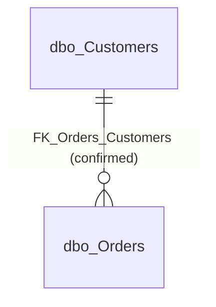

# Business areas

This page groups the tables of **SEH_Intelligence_Demo** into logical business areas. The database does
not store any business modules or descriptions (the exporter's AI annotation blocks are empty), so
**all area names and purposes on this page are Inferred** from table names, column names, the foreign key
and sample data. See the [database overview](database-overview.md) for the evidence labels and
[relationships](relationships.md) for join details.

## Overview

| Business area (Inferred) | Tables | Purpose (Inferred) |
|---|---|---|
| Customer Management | [`dbo.Customers`](documentation/customers.md) | Who the customers are: identity, contact email, city and when they were added. |
| Order Management | [`dbo.Orders`](documentation/orders.md) | What customers ordered: order date, total amount and current status. |

Every table in the inventory (2 of 2) is assigned to exactly one area. No "Other" area is needed.

Caption: *Customer Management* (`dbo_Customers`) and *Order Management* (`dbo_Orders`) are linked by one
confirmed foreign key. One customer has zero or many orders; each order has exactly one customer. There
are no inferred links.

## Customer Management (Inferred)

**Tables:** `dbo.Customers`

**Purpose (Inferred):** keep one record per customer, with a name, an optional email address, an optional
city and the time the record was created.

**Supporting evidence:**

- Table name `Customers` and column names `CustomerName`, `Email`, `City`, `CreatedDate` (Confirmed
  structure).
- The exporter classified `CustomerName` as a person name and `Email` as a contact email, based on the
  column names only (derived heuristic, not a business confirmation).
- `dbo.Customers` is the root table: it is referenced by Orders and references nothing (Confirmed).

**Uncertainties:**

- Whether a "customer" is a person, a company or both is unknown; the name heuristic suggests a person.
- No customer number other than the internal `CustomerId`, no status (active/inactive) and no address
  beyond city are stored.

## Order Management (Inferred)

**Tables:** `dbo.Orders`

**Purpose (Inferred):** record orders placed by customers, with an order date, a total amount that cannot
be negative and a current status.

**Supporting evidence:**

- Table name `Orders`, columns `OrderDate`, `TotalAmount`, `OrderStatus` (Confirmed structure).
- Required foreign key to `dbo.Customers` (Confirmed structure).
- Check constraint `TotalAmount >= 0` (Confirmed structure).
- Status values `Completed`, `Pending`, `Shipped` in the snapshot (Observed sample), which suggest a
  fulfilment process.

**Uncertainties:**

- Order lines (products, quantities, prices), payments and shipments are not in this database.
- Currency and the composition of `TotalAmount` are unknown.
- The full list and meaning of status values is unknown; only the current status is stored.

## How the areas connect

- **Within areas:** each area has a single table, so there are no within-area links.
- **Across areas:** `dbo.Orders.CustomerId` → `dbo.Customers.CustomerId` (`FK_Orders_Customers`,
  many-to-one, required, enabled and trusted, delete/update `NO_ACTION`). Order Management depends on
  Customer Management: an order cannot exist without a customer, and a customer with orders cannot be
  deleted.

## Plausible use cases and processes (Inferred)

These are not documented in the source; they are reasonable uses of the structure.

1. **Register a customer:** insert a customer with a name; email and city are optional; the creation time
   is filled in automatically (UTC) if not given.
2. **Place an order:** insert an order for an existing customer with a total amount of zero or more and a
   status (for example `Pending`). The order date defaults to the current UTC time if not given.
3. **Follow up an order:** update `OrderStatus` as the order progresses (for example to `Shipped` or
   `Completed`). The sequence of statuses is **not** enforced by the database and is not confirmed.
4. **Customer service lookup:** find a customer and list their orders with dates, amounts and statuses.

## Reporting opportunities and limitations

| Report (Inferred) | Built from | Limitations |
|---|---|---|
| Order count and value per customer | Orders joined to Customers | Currency unknown; decide whether `Pending` orders count as sales. |
| Orders by status | `Orders.OrderStatus` | Status meanings and complete value list unknown; free text, so spelling variants are possible. |
| Orders over time | `Orders.OrderDate` | Time zone of supplied dates unknown; snapshot covers only 1–4 Oct 2026. |
| Orders or customers by city | `Customers.City` | City is optional, free text and current only (no history); not a delivery location. |
| New customers over time | `Customers.CreatedDate` | All snapshot customers share one timestamp (bulk load), so it may not reflect when they became customers. |
| Customers without orders | Customers left-joined to Orders | None in the snapshot, but allowed by the structure. |

Counting pitfall: when customers and orders are joined, count distinct customers, not joined rows.
