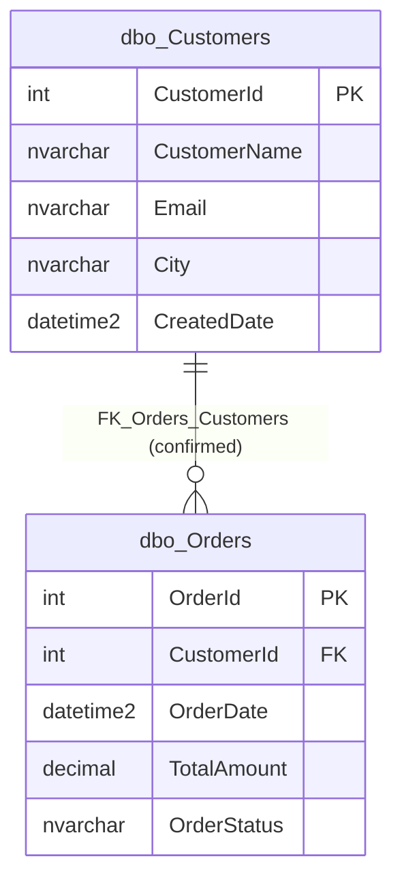

# Database overview: SEH_Intelligence_Demo

This is the starting page of the documentation for the **SEH_Intelligence_Demo** database. It was written
only from the MetaXtract export in [`../extracted/`](../extracted/database.json). The export holds the
database structure and sanitized sample rows. It does not include any stored business descriptions.

Related documents:

- [Relationships](relationships.md): how the tables connect.
- [Business areas](business-areas.md): how the tables are grouped by business topic.
- Table pages: [Customers](documentation/customers.md) and [Orders](documentation/orders.md).

## Business summary

**Inferred:** The database looks like a small **customer and order** store. One table holds customers
(with a name, an email address, a city and a creation time). The other holds orders placed by those
customers (with an order date, a total amount and a status). Every order must belong to exactly one
existing customer. A customer can have no orders, one order or many orders.

The database name contains "Demo", and the two tables hold only 7 rows in total. This suggests a
demonstration or test database rather than a production system (**Inferred**). The database has no
stored descriptions for itself, its schema, tables or columns, so every business meaning in this
documentation is **inferred** from names, data types, constraints and sample data, and needs business
validation.

## How to read the evidence labels

| Label | What it means |
|---|---|
| **Confirmed structure** | Read directly from the database system catalog: tables, columns, data types, keys, constraints, indexes, defaults. If a constraint were disabled or untrusted, it would be stated (all constraints here are enabled and trusted). |
| **Reported profile** | Statistics calculated by the exporter (for example null counts, distinct counts, minimum and maximum). Here they cover the full table **at the moment of export** only. |
| **Observed sample** | Patterns seen in the supplied sanitized rows, or calculations made from them. |
| **Inferred** | Proposed business meanings, groupings, relationships or rules. They are reasonable interpretations, not facts, and need validation. |
| **Unknown** | Information that the supplied files do not provide. |

The exporter also marks some values as **derived** (computed by the tool, for example relationship
cardinality and sensitivity classification). Derived values are tool heuristics and are not independent
business confirmation.

## Source inventory and export run

| Item | Value |
|---|---|
| Input files | [`database.json`](../extracted/database.json), [`dbo.Customers.json`](../extracted/dbo.Customers.json), [`dbo.Customers.data.json`](../extracted/dbo.Customers.data.json), [`dbo.Orders.json`](../extracted/dbo.Orders.json), [`dbo.Orders.data.json`](../extracted/dbo.Orders.data.json) |
| Missing files | None. Every table listed in the inventory has a schema file and a data file (data file status `generated`). |
| Generator | MetaXtract 1.0.0, file schema version 1.0 |
| Export run | Run id `20261017T114024Z-d86ce467`, started 2026-10-17 11:40:24 UTC, completed 11:40:25 UTC (1,520 ms), status `Succeeded` |
| Files written | 2 schema files, 2 data files, 0 data files failed |
| Warnings / errors | None reported |
| Consistency between files | All five files carry the same run id and generation time, and their counts agree with each other. |

**Export settings** (these affect how the samples and counts should be read):

| Setting | Value | Plain meaning |
|---|---|---|
| `maxRowsPerTable` | 100 | At most 100 sample rows per table are exported. |
| `maxStringLength` | 500 | Longer text values would be cut to 500 characters (no value was cut). |
| `fullProfileMaxRows` | 1,000,000 | Tables up to this size get full-table statistics; both tables qualified. |
| `includeSchemas` / `excludeSchemas` | empty / empty | No schema filter: all schemas were exported. |
| `exactRowCounts` | false | Row counts come from the catalog (`sys.partitions`), which is normally accurate but not guaranteed to be an exact count. |
| `maskTokensStableAcrossRuns` | false | Masked values cannot be compared between different export runs. |
| `freeTextScrubbing` | true | Personal data or secrets found inside free text are redacted (none were found). |

The source server name is recorded in the export but deliberately left out of this documentation,
because it is an infrastructure detail.

## Database facts (Confirmed structure)

| Property | Value |
|---|---|
| Name | SEH_Intelligence_Demo |
| Provider | SqlServer (Microsoft SQL Server) |
| Product version | 16.0.1200.5 (SQL Server 2022 version line) |
| Edition | Developer Edition (64-bit), a non-production licence edition |
| Collation | `SQL_Latin1_General_CP1_CI_AS` (Latin alphabet; text comparison is **case-insensitive** and **accent-sensitive**) |
| Compatibility level | 160 |
| Creation date | 2026-10-16 10:59:21 (as reported by the server; the time zone is not stated) |
| Description | None stored |
| Extended properties | None |

### Schemas

| Schema | Owner | Description | Tables | Views | Routines | Tables in schema |
|---|---|---|---|---|---|---|
| `dbo` | `dbo` | None stored | 2 | 0 | 0 | Customers, Orders |

### Summary counts

Reported by the exporter (derived from confirmed catalog facts):

| Count | Value | Count | Value |
|---|---|---|---|
| Schemas | 1 | Unique constraints | 0 |
| Tables | 2 | Check constraints | 1 |
| Columns | 10 | Default constraints | 2 |
| Rows (catalog) | 7 | Triggers | 0 |
| Relationships (foreign keys) | 1 | Views | 0 |
| Indexes | 2 | Stored procedures | 0 |
| Tables with description | 0 | Functions | 0 |
| Columns with description | 0 | Sensitive columns | 2 |

| Structural list | Value |
|---|---|
| Tables without a primary key | None |
| Tables without relationships | None |
| Empty tables | None |
| Largest tables | `dbo.Orders` (4 rows), `dbo.Customers` (3 rows) |
| Root tables (referenced, but referencing nothing) | `dbo.Customers` |

## Table inventory

| Table | Proposed business area (Inferred) | Purpose (Inferred) | Rows (catalog) | Columns | Primary key | Related tables | Documentation | Source |
|---|---|---|---|---|---|---|---|---|
| `dbo.Customers` | Customer Management | List of customers who can place orders | 3 | 5 | `CustomerId` | `dbo.Orders` | [customers.md](documentation/customers.md) | [schema](../extracted/dbo.Customers.json), [data](../extracted/dbo.Customers.data.json) |
| `dbo.Orders` | Order Management | Orders placed by customers, with date, total amount and status | 4 | 5 | `OrderId` | `dbo.Customers` | [orders.md](documentation/orders.md) | [schema](../extracted/dbo.Orders.json), [data](../extracted/dbo.Orders.data.json) |

Both tables are ordinary tables (type `TABLE`), not partitioned and not temporal (no automatic history
tracking by the database).

## Overall ER diagram

**How to read the diagram:** each box is a table with its columns (data type, then column name;
`PK` = primary key, `FK` = foreign key). The line between the boxes is the one confirmed foreign key.
The `||` next to Customers means "exactly one customer"; the `o{` next to Orders means "zero, one or many
orders". In words: each order belongs to exactly one customer, and a customer can have any number of
orders, including none. There are no inferred relationships in this database, so the diagram shows only
the confirmed one.

## Important structural safeguards (Confirmed structure)

- **Unique identifiers.** Each table has a clustered primary key on an automatically numbered integer
  column (`IDENTITY(1,1)`): `Customers.CustomerId` and `Orders.OrderId`.
- **Every order has an existing customer.** The foreign key `FK_Orders_Customers` is enabled and trusted,
  and `Orders.CustomerId` cannot be empty (NOT NULL). An order cannot point to a customer that does not
  exist.
- **Customers with orders cannot be deleted or renumbered** while orders refer to them: the delete and
  update rules are `NO_ACTION` (the database blocks the change instead of cascading it).
- **Order amounts cannot be negative.** The check constraint `CK_Orders_TotalAmount` (`[TotalAmount]>=(0)`)
  is enabled and trusted. Zero is allowed.
- **Automatic timestamps.** `Customers.CreatedDate` and `Orders.OrderDate` default to the current UTC
  time (`sysutcdatetime()`) when no value is supplied.
- **Required fields.** Customer name, order date, total amount and order status are required; email and
  city are optional.

What is **not** enforced: email addresses and customer names are not unique; order status is free text
(up to 30 characters) with no list of allowed values; there is no index on `Orders.CustomerId`.

## Observed patterns (Reported profile / Observed sample)

The sample files hold **every row** of both tables (100 % coverage), and the profiles cover the full
tables, but only as they were at export time on 2026-10-17.

- 3 customers and 4 orders. Customer 1 has 2 orders; customers 2 and 3 have 1 order each. Every customer
  has at least one order in this snapshot.
- Order dates run from 2026-10-01 to 2026-10-04, one order per day, each at exactly midnight.
- All three customers have the **same** creation timestamp (2026-10-16 05:29:25.038742), which suggests
  they were inserted together in one load.
- Order totals range from 1,500.00 to 3,200.00; the sum of all four orders is 9,000.00 (currency unknown).
- Order status values seen: `Completed` (2), `Pending` (1), `Shipped` (1).
- Name and email values are masked in the export; every customer has an email and a city in this snapshot.

## Validation questions

1. **Date chronology.** Every order (1–4 October 2026) is dated *before* its customer's creation time
   (16 October 2026). Was the order history loaded with back-dated values, does `CreatedDate` mean "date
   added to this system" rather than "customer since", or is this demo data?
2. **Time zones.** `CreatedDate` and `OrderDate` default to UTC. Are explicitly supplied order dates
   (all at midnight) also UTC, or local business dates?
3. **Currency and amount meaning.** In which currency is `TotalAmount` stored? Does it include tax,
   discounts and shipping? Is it calculated from order lines kept elsewhere?
4. **Status values.** What is the full list of allowed `OrderStatus` values, what does each mean, and in
   which order do they occur (for example Pending → Shipped → Completed)? Is there a cancelled status?
5. **Status history.** Only the current status is stored. Is status history kept anywhere?
6. **Customer identity.** Should email addresses be unique per customer? How are duplicate customers
   prevented?
7. **Order details.** Products, quantities, payments and shipping addresses do not appear in this
   database. Are they held in another system?

## Boundaries: what these files can and cannot explain

These files **can** explain the structure of the two tables, how they are connected, which rules the
database enforces, and what the data looked like at export time.

They **cannot** explain:

- the official business meaning of any table or column (no stored descriptions exist);
- currency, tax rules, status meanings or status workflows;
- application behaviour, validation done outside the database, or how and by whom data is entered;
- history: the tables are not temporal, so earlier values are not kept;
- whether this small snapshot represents a production system (the database appears to be a demo);
- the masked customer names and emails (they cannot be recovered and are not shown);
- other databases or systems that may hold related data. The absence of a table here does not mean the
  business does not have that information elsewhere.
