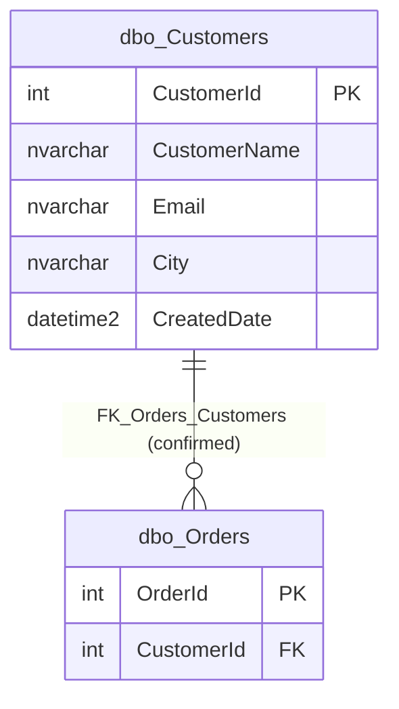

# Customers (`dbo.Customers`)

Source files: [`dbo.Customers.json`](../../extracted/dbo.Customers.json) (structure),
[`dbo.Customers.data.json`](../../extracted/dbo.Customers.data.json) (sanitized sample and profile),
[`database.json`](../../extracted/database.json) (inventory).
Related documentation: [database overview](../database-overview.md) ·
[relationships](../relationships.md) · [business areas](../business-areas.md) ·
[Orders](orders.md).

Evidence labels used on this page: **Confirmed structure**, **Reported profile**, **Observed sample**,
**Inferred**, **Unknown** (explained in the [database overview](../database-overview.md#how-to-read-the-evidence-labels)).

## Business purpose

**Inferred:** This table is the list of customers. Each customer can place orders, which are stored in
[`dbo.Orders`](orders.md).

**Proposed business area (Inferred):** Customer Management.

**One record represents (Inferred):** one customer, identified by an automatically assigned number
(`CustomerId`), with a name, an optional email address, an optional city and the time the record was
created.

The database stores **no description** for this table or any of its columns, so these meanings are
inferred from names, types and data.

## Key facts

| Fact | Value | Evidence |
|---|---|---|
| Full name | `dbo.Customers` (schema `dbo`) | Confirmed structure |
| Type | `TABLE` (ordinary table) | Confirmed structure |
| Object id | 901578250 | Confirmed structure |
| Created | 2026-10-16 10:59:25.01 (server time; time zone not stated) | Confirmed structure |
| Last modified (structure) | 2026-10-16 10:59:25.02 | Confirmed structure |
| Row count | 3 (source `catalog:sys.partitions`, not an exact count; matches the 3 rows exported) | Confirmed structure / Observed sample |
| Columns | 5 | Confirmed structure |
| Primary key | `PK_Customers` on `CustomerId` (clustered) | Confirmed structure |
| Temporal (history) table | No | Confirmed structure |
| Partitioned | No | Confirmed structure |
| Description / extended properties | None stored | Confirmed structure |
| Role in relationships | Root table: referenced by `dbo.Orders`, references nothing | Confirmed structure |
| Columns classified as sensitive | 2 (`CustomerName`, `Email`), by name heuristic | Derived by exporter |
| Indexes / check constraints / triggers / dependent objects | 1 / 0 / 0 / 0 | Confirmed structure |

### Sample and profile coverage

| Item | Value |
|---|---|
| Sample rows returned | 3 of 3 (coverage 100 %, complete table at export time) |
| Maximum sample size | 100 rows |
| Sampling strategy | `RecentByDateColumn`: newest rows by `CreatedDate` (descending), ties broken by `CustomerId` (descending); deterministic |
| Sample date range (`CreatedDate`) | 2026-10-16 05:29:25.038742 to the same value |
| Profile scope | Full-table statistics (`fullTableStatistics: true`) at the time of export on 2026-10-17 |
| Sanitization | `CustomerName` and `Email` masked (keyed-hash tokens, not stable across runs); other columns included; no values truncated; no free-text redactions |

The profile describes this one snapshot. It does not establish permanent rules.

## Field guide

### Storage rules (Confirmed structure)

| # | Column | Type | Required | Key / unique | Identity | Default | Collation | Sensitivity (derived) |
|---|---|---|---|---|---|---|---|---|
| 1 | `CustomerId` | `int` | Yes (NOT NULL) | Primary key (unique) | Yes, seed 1, increment 1 | None | n/a | None |
| 2 | `CustomerName` | `nvarchar(100)` (max 100 characters, Unicode) | Yes (NOT NULL) | No | No | None | `SQL_Latin1_General_CP1_CI_AS` | PersonName (name heuristic: "Column name suggests person name"; masked) |
| 3 | `Email` | `nvarchar(150)` (max 150 characters, Unicode) | No (NULL allowed) | No | No | None | `SQL_Latin1_General_CP1_CI_AS` | ContactEmail (name heuristic: "Column name suggests email address"; masked) |
| 4 | `City` | `nvarchar(100)` (max 100 characters, Unicode) | No (NULL allowed) | No | No | None | `SQL_Latin1_General_CP1_CI_AS` | None |
| 5 | `CreatedDate` | `datetime2(7)` (date and time, 7 decimal places of seconds) | Yes (NOT NULL) | No | No | `DF_Customers_CreatedDate`: `(sysutcdatetime())` | n/a | None |

For all columns: not computed, not row-GUID, not sparse, no generated-always type, no stored description,
no extended properties, no database data classification (`dataClassification` is null). Only
`CustomerId` is indexed.

### Meanings (Inferred)

| Column | Likely meaning | Notes and limitations |
|---|---|---|
| `CustomerId` | Internal customer number, assigned automatically by the database (1, 2, 3, ...). Used by orders to point to their customer. | Gaps in the numbering are normal (for example after a failed insert or a deleted customer) and carry no meaning. It is not necessarily a customer number shown to customers. |
| `CustomerName` | The customer's name. | Required. Not unique: two customers may have the same name. Whether it is a person's name or a company name is unknown. Treated as personal data. |
| `Email` | The customer's contact email address. | Optional. Not unique and not format-checked by the database. Treated as personal data. |
| `City` | The city where the customer is located. | Optional free text; there is no country, address or reference list of cities. It holds the current value only. The exporter classified it as not sensitive, but location data can still be personal when combined with other fields. |
| `CreatedDate` | When the customer record was created, in UTC. | Filled automatically with the current UTC time if no value is given; a supplied value is accepted as is. It may record when the row was loaded rather than when the person became a customer (see observations). |

## Relationships

| Direction | Related table | This table's columns | Related columns | Cardinality | Evidence |
|---|---|---|---|---|---|
| Incoming | [`dbo.Orders`](orders.md) | `CustomerId` | `CustomerId` | one customer to many orders | Confirmed structure (`FK_Orders_Customers`) |

Details of `FK_Orders_Customers`: enabled, trusted, delete rule `NO_ACTION`, update rule `NO_ACTION`,
not a self-reference. The order's `CustomerId` is required, so every order has exactly one customer; a
customer may have zero, one or many orders. In practice this means **a customer who still has orders
cannot be deleted**.

**Outgoing relationships:** none. This table does not refer to any other table.

**Inferred relationships:** none. `Customers.CustomerId` and `Orders.OrderId` both count up from 1 and
share values, but they are independent numbers and must not be joined (see
[relationships](../relationships.md#candidates-reviewed-and-rejected)).

Reading the diagram: one customer (`||`, exactly one) has zero or many orders (`o{`). The line is a
confirmed foreign key. Only the key columns of Orders are shown; see [Orders](orders.md) for all of them.

## Constraints, defaults and indexes (Confirmed structure)

| Object | Type | Columns | Definition | Practical meaning |
|---|---|---|---|---|
| `PK_Customers` | Primary key, clustered unique index (ascending) | `CustomerId` | n/a | Each customer number is unique and present. Rows are physically ordered by `CustomerId`, so lookups by customer number are fast. Not disabled; no filter; no included columns. |
| `DF_Customers_CreatedDate` | Default | `CreatedDate` | `(sysutcdatetime())` | If the creation time is not supplied, the database fills in the current UTC date and time. |

There are no unique constraints (so names and emails may repeat), no check constraints, no triggers
and no dependent objects (no views, procedures or functions use this table, according to
`sys.sql_expression_dependencies`; dynamic SQL references are not detected). The foreign key that refers
to this table belongs to `dbo.Orders`.

## Business rules

| Rule | Evidence |
|---|---|
| Every customer has a unique, automatically assigned number. | Confirmed structure |
| A customer must have a name; email and city are optional. | Confirmed structure |
| The creation time defaults to the current UTC time. | Confirmed structure |
| A customer who has orders cannot be deleted or renumbered. | Confirmed structure (foreign key from Orders, `NO_ACTION`) |
| Each customer should have one record (no duplicate customers). | Inferred, **not enforced**: no unique constraint on name or email. |
| Email should be a valid, perhaps unique, address. | Inferred, **not enforced** by the database. |

## Sanitized examples (Observed sample)

All three rows of the table at export time. Name and email are masked in the export; they are shown as
`[hidden]`, an editorial placeholder that is neither a stored value nor an empty value. City values are
also shown as `[hidden]` because they are not needed to explain the data.

| CustomerId | CustomerName | Email | City | CreatedDate (UTC) | Orders in snapshot |
|---|---|---|---|---|---|
| 1 | [hidden] | [hidden] | [hidden] | 2026-10-16 05:29:25.038742 | 2 (orders 1 and 2) |
| 2 | [hidden] | [hidden] | [hidden] | 2026-10-16 05:29:25.038742 | 1 (order 3) |
| 3 | [hidden] | [hidden] | [hidden] | 2026-10-16 05:29:25.038742 | 1 (order 4) |

## Profile observations (Reported profile, full table at export time)

| Column | Nulls | Distinct | Unique in snapshot | Min | Max | Text length (min / max / avg) |
|---|---|---|---|---|---|---|
| `CustomerId` | 0 (0 %) | 3 (100 %) | Yes | 1 | 3 | n/a |
| `CustomerName` | 0 (0 %) | 3 (100 %) | Yes | not reported (masked) | not reported | not reported |
| `Email` | 0 (0 %) | 3 (100 %) | Yes | not reported (masked) | not reported | not reported |
| `City` | 0 (0 %) | 3 (100 %) | Yes | not reported | not reported | 5 / 6 / 5.33 |
| `CreatedDate` | 0 (0 %) | 1 (33.33 %) | No | 2026-10-16 05:29:25.038742 | same | n/a |

What this shows, for this snapshot only:

- Every customer had an email and a city, even though both are optional.
- Names, emails and cities were all different, but nothing in the database requires that.
- `CustomerId` values 1–3 have no gaps.
- All three customers were created at the **same instant**, which suggests a single bulk insert
  (Inferred). The table's catalog creation time (10:59:25 server time) and this UTC value (05:29:25) are
  about 5½ hours apart, which is consistent with the rows being inserted right after the table was
  created on a server running in a different time zone (Inferred; the server time zone is not reported).
- No top-value lists were reported for this table.

## Common business use cases (Inferred)

- Look up a customer and list their orders.
- Count customers, or count new customers over time (with the caution below about `CreatedDate`).
- Group customers or their orders by city.
- Contact customers by email (subject to privacy rules).

## Assumptions and validation questions

1. Is a customer a person, a company, or either?
2. Should email addresses (or names) be unique? How are duplicate customers detected?
3. Does `CreatedDate` mean "customer since" or "record loaded"? In the snapshot all customers were created
   on 16 October 2026, after their orders (1–4 October 2026).
4. Is `City` the billing, delivery or home city? Is a country needed to make it unambiguous?
5. How should customers be removed (for example on a privacy request) given that customers with orders
   cannot be deleted?
6. Is any customer status (active, blocked) kept elsewhere?
