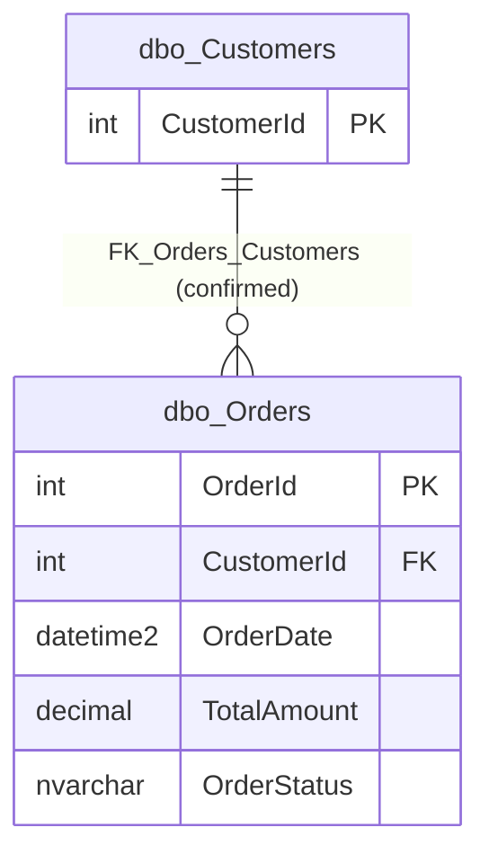

# Orders (`dbo.Orders`)

Source files: [`dbo.Orders.json`](../../extracted/dbo.Orders.json) (structure),
[`dbo.Orders.data.json`](../../extracted/dbo.Orders.data.json) (sanitized sample and profile),
[`database.json`](../../extracted/database.json) (inventory).
Related documentation: [database overview](../database-overview.md) ·
[relationships](../relationships.md) · [business areas](../business-areas.md) ·
[Customers](customers.md).

Evidence labels used on this page: **Confirmed structure**, **Reported profile**, **Observed sample**,
**Inferred**, **Unknown** (explained in the [database overview](../database-overview.md#how-to-read-the-evidence-labels)).

## Business purpose

**Inferred:** This table records orders placed by customers. For each order it keeps the date, the total
amount and the current status.

**Proposed business area (Inferred):** Order Management.

**One record represents (Inferred):** one order placed by one customer (from
[`dbo.Customers`](customers.md)), as a whole: one total amount and one current status. Individual
products or order lines are not stored here.

The database stores **no description** for this table or any of its columns, so these meanings are
inferred from names, types, constraints and data.

## Key facts

| Fact | Value | Evidence |
|---|---|---|
| Full name | `dbo.Orders` (schema `dbo`) | Confirmed structure |
| Type | `TABLE` (ordinary table) | Confirmed structure |
| Object id | 949578421 | Confirmed structure |
| Created | 2026-10-16 10:59:25.017 (server time; time zone not stated) | Confirmed structure |
| Last modified (structure) | 2026-10-16 10:59:25.017 | Confirmed structure |
| Row count | 4 (source `catalog:sys.partitions`, not an exact count; matches the 4 rows exported) | Confirmed structure / Observed sample |
| Columns | 5 | Confirmed structure |
| Primary key | `PK_Orders` on `OrderId` (clustered) | Confirmed structure |
| Foreign key | `FK_Orders_Customers`: `CustomerId` → `dbo.Customers.CustomerId` | Confirmed structure |
| Temporal (history) table | No | Confirmed structure |
| Partitioned | No | Confirmed structure |
| Description / extended properties | None stored | Confirmed structure |
| Role in relationships | Leaf table: references `dbo.Customers`, referenced by nothing | Confirmed structure |
| Columns classified as sensitive | 0 | Derived by exporter |
| Indexes / check constraints / triggers / dependent objects | 1 / 1 / 0 / 1 (the check constraint) | Confirmed structure |

### Sample and profile coverage

| Item | Value |
|---|---|
| Sample rows returned | 4 of 4 (coverage 100 %, complete table at export time) |
| Maximum sample size | 100 rows |
| Sampling strategy | `RecentByDateColumn`: newest rows by `OrderDate` (descending), ties broken by `OrderId` (descending); deterministic |
| Sample date range (`OrderDate`) | 2026-10-01 00:00:00 to 2026-10-04 00:00:00 |
| Profile scope | Full-table statistics (`fullTableStatistics: true`) at the time of export on 2026-10-17 |
| Sanitization | All columns included unmasked (no column classified as sensitive); no values truncated; no free-text redactions |

The profile describes this one snapshot. It does not establish permanent rules.

## Field guide

### Storage rules (Confirmed structure)

| # | Column | Type | Required | Key / unique | Identity | Default | Collation | Sensitivity (derived) |
|---|---|---|---|---|---|---|---|---|
| 1 | `OrderId` | `int` | Yes (NOT NULL) | Primary key (unique) | Yes, seed 1, increment 1 | None | n/a | None |
| 2 | `CustomerId` | `int` | Yes (NOT NULL) | Foreign key → `dbo.Customers.CustomerId`; not unique; not indexed | No | None | n/a | None |
| 3 | `OrderDate` | `datetime2(7)` (date and time, 7 decimal places of seconds) | Yes (NOT NULL) | No | No | `DF_Orders_OrderDate`: `(sysutcdatetime())` | n/a | None |
| 4 | `TotalAmount` | `decimal(12,2)` (up to 12 digits, 2 after the decimal point, so at most 9,999,999,999.99) | Yes (NOT NULL) | No | No | None | n/a | None |
| 5 | `OrderStatus` | `nvarchar(30)` (max 30 characters, Unicode) | Yes (NOT NULL) | No | No | None | `SQL_Latin1_General_CP1_CI_AS` (case-insensitive) | None |

For all columns: not computed, not row-GUID, not sparse, no generated-always type, no stored description,
no extended properties, no database data classification. Only `OrderId` is indexed.

### Meanings (Inferred)

| Column | Likely meaning | Notes and limitations |
|---|---|---|
| `OrderId` | Internal order number, assigned automatically (1, 2, 3, ...). | Gaps are normal and carry no meaning. Unrelated to `CustomerId` even though the numbers overlap. |
| `CustomerId` | The customer who placed the order. | Required and checked against `dbo.Customers`. One customer can have many orders. |
| `OrderDate` | When the order was placed. | Defaults to the current **UTC** time if not given. All snapshot values are exactly midnight, so they were most likely supplied explicitly as dates (Inferred); their time zone is unknown. |
| `TotalAmount` | Total value of the order. | Cannot be negative (zero allowed). Currency is **unknown**; whether it includes tax, discounts or shipping is unknown; it is not calculated by the database. |
| `OrderStatus` | Current stage of the order. | Free text up to 30 characters with no list of allowed values. Values seen: `Completed`, `Pending`, `Shipped`. Only the current status is kept; no history. Because of the case-insensitive collation, `pending` and `Pending` compare as equal in queries. |

## Relationships

| Direction | Related table | This table's columns | Related columns | Cardinality | Evidence |
|---|---|---|---|---|---|
| Outgoing | [`dbo.Customers`](customers.md) | `CustomerId` | `CustomerId` | many orders to one customer | Confirmed structure (`FK_Orders_Customers`) |

Details of `FK_Orders_Customers`: enabled and trusted (checked for all new and existing rows), delete
rule `NO_ACTION`, update rule `NO_ACTION`, not a self-reference, no stored description. Exporter-derived
cardinality: many-to-one, parent required. In practice: **every order belongs to exactly one existing
customer**, and that customer cannot be deleted while the order exists.

**Incoming relationships:** none. No table refers to orders.

**Inferred relationships:** none. See the rejected candidates on the
[relationships page](../relationships.md#candidates-reviewed-and-rejected), in particular: do not join
`OrderId` to `Customers.CustomerId`.

Reading the diagram: each order (`o{`, zero or many per customer) points to exactly one customer (`||`).
The line is a confirmed foreign key. Only the key column of Customers is shown; see
[Customers](customers.md) for all of them.

## Constraints, defaults and indexes (Confirmed structure)

| Object | Type | Columns | Definition | Practical meaning |
|---|---|---|---|---|
| `PK_Orders` | Primary key, clustered unique index (ascending) | `OrderId` | n/a | Each order number is unique and present; rows are stored in order-number order. Not disabled; no filter; no included columns. |
| `FK_Orders_Customers` | Foreign key (enabled, trusted) | `CustomerId` → `dbo.Customers.CustomerId` | delete `NO_ACTION`, update `NO_ACTION` | An order must name an existing customer. |
| `CK_Orders_TotalAmount` | Check constraint (enabled, trusted) | `TotalAmount` | `([TotalAmount]>=(0))` | The total amount must be zero or more. Negative amounts (for example refunds as negative orders) are rejected. |
| `DF_Orders_OrderDate` | Default | `OrderDate` | `(sysutcdatetime())` | If no order date is supplied, the current UTC date and time is stored. |

**Index note:** there is no index on `CustomerId`. Finding all orders of one customer, or checking the
foreign key when a customer is deleted, requires reading the whole table. This is irrelevant at 4 rows but
may matter for larger volumes.

**Dependencies:** the only object that depends on this table is the check constraint
`dbo.CK_Orders_TotalAmount` (type `CHECK_CONSTRAINT`, uses column `TotalAmount`). This is the table's own
rule, **not** a link to another table. No views, procedures or functions use the table (according to
`sys.sql_expression_dependencies`; dynamic SQL references are not detected).

**Triggers:** none. Nothing happens automatically when orders are inserted, updated or deleted, apart
from the default and the checks above.

## Business rules

| Rule | Evidence |
|---|---|
| Every order has a unique, automatically assigned number. | Confirmed structure |
| Every order belongs to exactly one existing customer. | Confirmed structure |
| Order date, total amount and status are required. | Confirmed structure |
| The total amount cannot be negative. | Confirmed structure |
| The order date defaults to the current UTC time. | Confirmed structure |
| Orders move through statuses such as Pending → Shipped → Completed. | Inferred from status names only; **not enforced**, and the order of statuses is not confirmed. |
| Total amounts are positive and between 1,500 and 3,200. | Observed sample only; **not a rule**. Zero is allowed and other values are possible. |

## Sanitized examples (Observed sample)

All four rows of the table at export time (no values are masked in this table).

| OrderId | CustomerId | OrderDate | TotalAmount | OrderStatus |
|---|---|---|---|---|
| 1 | 1 | 2026-10-01 00:00:00 | 1,500.00 | Completed |
| 2 | 1 | 2026-10-02 00:00:00 | 2,500.00 | Pending |
| 3 | 2 | 2026-10-03 00:00:00 | 3,200.00 | Completed |
| 4 | 3 | 2026-10-04 00:00:00 | 1,800.00 | Shipped |

Calculations from these rows: total 9,000.00 across all orders (currency unknown); average 2,250.00 per
order; customer 1 has 4,000.00 over 2 orders. Note that customer 1's older order is `Completed` while the
newer one is `Pending`, which is a normal pattern if statuses describe each order independently.

## Profile observations (Reported profile, full table at export time)

| Column | Nulls | Distinct | Unique in snapshot | Min | Max | Text length (min / max / avg) | Top values (sample) |
|---|---|---|---|---|---|---|---|
| `OrderId` | 0 (0 %) | 4 (100 %) | Yes | 1 | 4 | n/a | not reported |
| `CustomerId` | 0 (0 %) | 3 (75 %) | No | 1 | 3 | n/a | 1 (2 orders), 2 (1), 3 (1) |
| `OrderDate` | 0 (0 %) | 4 (100 %) | Yes | 2026-10-01 00:00:00 | 2026-10-04 00:00:00 | n/a | not reported |
| `TotalAmount` | 0 (0 %) | 4 (100 %) | Yes | 1,500.00 | 3,200.00 | n/a | not reported |
| `OrderStatus` | 0 (0 %) | 3 (75 %) | No | not reported | not reported | 7 / 9 / 8 | Completed (2), Pending (1), Shipped (1) |

What this shows, for this snapshot only: the three distinct `CustomerId` values cover all three
customers; order dates are one per day; amounts and dates happened to be unique, but nothing requires
that.

## Common business use cases (Inferred)

- List a customer's orders with date, amount and status.
- Report order counts and order value by day, by status or by customer.
- Track open orders (for example `Pending` or `Shipped`, if those mean "not finished").

**Reporting cautions:** decide which statuses count as sales; currency is unknown; when joining to
customers, count distinct customers rather than rows.

## Assumptions and validation questions

1. What currency is `TotalAmount` in, and what does it include (tax, discounts, shipping)?
2. What is the complete list of statuses, their meanings and the allowed order of changes? Is there a
   cancelled or returned status, and how are refunds recorded given that amounts cannot be negative?
3. Are supplied order dates UTC or local dates? Why are all snapshot orders (1–4 October 2026) dated
   before their customers' creation time (16 October 2026)?
4. Are order lines, payments and shipments stored in another system?
5. Is status history needed? The table keeps only the current status.
6. Should `CustomerId` be indexed for larger volumes?
