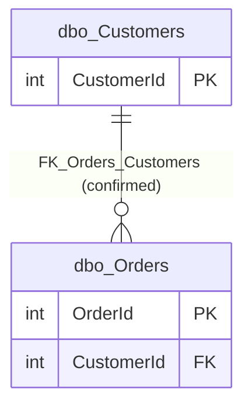

# Relationships

This page explains how the tables in **SEH_Intelligence_Demo** are connected. It is based only on the
MetaXtract export ([`database.json`](../extracted/database.json),
[`dbo.Customers.json`](../extracted/dbo.Customers.json), [`dbo.Orders.json`](../extracted/dbo.Orders.json)
and their data files). See the [database overview](database-overview.md) for the evidence labels and the
[business areas](business-areas.md) for the grouping of tables.

## Summary

| Relationship | From (child) | To (parent) | Cardinality | Evidence |
|---|---|---|---|---|
| `FK_Orders_Customers` | `dbo.Orders.CustomerId` | `dbo.Customers.CustomerId` | many orders to one customer | **Confirmed structure** (foreign key) |

There is **one confirmed relationship** and **no defensible inferred relationship**. The review of other
candidates is below.

## Confirmed relationships

### FK_Orders_Customers: each order belongs to one customer

| Property | Value | Plain meaning |
|---|---|---|
| Name | `FK_Orders_Customers` | The foreign key constraint's name in the database. |
| Source (child) | `dbo.Orders` → column `CustomerId` (`int`, NOT NULL) | The order stores the number of the customer who placed it. |
| Target (parent) | `dbo.Customers` → column `CustomerId` (`int`, primary key, identity) | The customer's unique number. |
| Target uniqueness | Yes: `CustomerId` is the primary key of `dbo.Customers` (`PK_Customers`) | Each value identifies exactly one customer. |
| Enabled | `true` | The database checks this rule on every insert and update. |
| Trusted | `true` | All existing rows were verified against the rule; the database can rely on it. |
| On delete | `NO_ACTION` | A customer who still has orders cannot be deleted; the delete is rejected. |
| On update | `NO_ACTION` | A customer number that orders still use cannot be changed (and `CustomerId` is an identity column, which normally cannot be updated anyway). |
| Self-reference | No | The relationship links two different tables. |
| Description | None stored | |
| Cardinality (derived by exporter) | many-to-one | Many orders can point to the same customer. |
| Parent optionality (derived) | required | Every order must have a customer, because the column is NOT NULL. |
| Child optionality (Confirmed structure) | zero or more | Nothing forces a customer to have orders. |
| Supporting index on the child column | None | `Orders.CustomerId` has no index. This does not affect correctness, but looking up a customer's orders, or deleting a customer, may need to scan all orders in a larger dataset. |

**Notation:** `||` on the Customers side means "exactly one"; `o{` on the Orders side means "zero or
many". Read it as: *one customer has zero or many orders; each order has exactly one customer.* The label
"confirmed" means a foreign key in the database enforces this line.

#### Sanitized examples of connected records (Observed sample)

The sample contains all rows of both tables (100 % coverage at export time). Customer names and emails
are masked in the export and are shown here as `[hidden]`; this is an editorial placeholder, not a stored
value and not an empty value.

| OrderId | Orders.CustomerId | Customer name | OrderDate | TotalAmount | OrderStatus |
|---|---|---|---|---|---|
| 1 | 1 | [hidden] | 2026-10-01 | 1,500.00 | Completed |
| 2 | 1 | [hidden] | 2026-10-02 | 2,500.00 | Pending |
| 3 | 2 | [hidden] | 2026-10-03 | 3,200.00 | Completed |
| 4 | 3 | [hidden] | 2026-10-04 | 1,800.00 | Shipped |

Observations from the snapshot:

- All 4 orders point to a customer that exists (as the trusted foreign key guarantees).
- Customer 1 has 2 orders; customers 2 and 3 have 1 each. No customer is without orders in this snapshot,
  but the structure allows it.
- Orders per customer: total 4,000.00 for customer 1, 3,200.00 for customer 2 and 1,800.00 for
  customer 3 (currency unknown).

## Inferred relationships

**None.** No additional relationship without a foreign key is supported by the evidence. With only two
tables and one foreign key already covering the obvious link, there is no further column that names,
types and values together point to.

## Candidates reviewed and rejected

| Candidate | Why it looks possible | Why it is rejected |
|---|---|---|
| `Orders.OrderId` ↔ `Customers.CustomerId` | Both are `int` identity columns starting at 1; values 1–3 appear in both tables. | Overlapping numbers come from two independent counters. The names refer to different things (order vs customer). Joining them would match unrelated records. |
| `Orders.OrderDate` ↔ `Customers.CreatedDate` | Both are `datetime2(7)` with the same UTC default. | Dates are not identifiers. The values also do not match (orders 1–4 October, customers 16 October). A customer's first order cannot be assumed to be its creation event. |
| `Orders.CustomerId` ↔ `Customers.CustomerId` as one-to-one | Customers 2 and 3 have exactly one order each. | Customer 1 has two orders, and `Orders.CustomerId` has no unique constraint. The relationship is one-to-many. |

## Interpreting joins and reports

- **Orders with customer details:** join `Orders.CustomerId` to `Customers.CustomerId`. Because the foreign
  key is trusted and the column is required, an inner join keeps every order: no order is lost.
- **Customers with their orders:** start from Customers and use a left (outer) join to Orders if customers
  without orders should still appear. An inner join would drop them (none exist in this snapshot, but new
  customers may have none).
- **Counting pitfall:** after joining customers to orders, each customer appears once per order. Count
  distinct `CustomerId` values to count customers, and do not add up customer-level values (for example a
  customer count per city) over joined rows. In the snapshot, customer 1 would appear twice.
- **Sum pitfall:** `TotalAmount` is an order-level total. Summing it per customer is fine; summing it after
  joining to any future line-level table would double count. Whether to include `Pending` orders in revenue
  is a business decision (status meanings are unknown).
- **City reporting:** `City` belongs to the customer, not to the order. Reporting orders "by city" uses the
  customer's **current** city; the database keeps no history of earlier cities or a shipping location.

## Validation questions

1. Should customers with orders ever be removable (for example for data-privacy requests)? Today the
   `NO_ACTION` rule blocks this.
2. Is an index on `Orders.CustomerId` wanted for larger data volumes?
3. Can an order ever be transferred to a different customer?
4. Are there other systems (order lines, payments, shipments) that link to `OrderId` or `CustomerId`?
   They are not part of this export.
